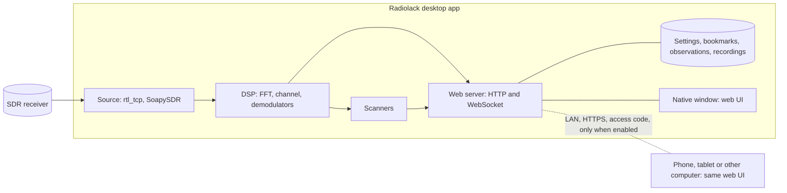

# Radiolack rewrite: scoping

Status: v0 merged into `main` and released as 0.2.0 on 2026-11-10 (started
on the `rewrite` branch on 2026-11-08), and accepted by the owner the same
day with one check left (see v0 below). v1, remote access, started on
2026-11-11. v2, the scanners, was designed with the owner on 2026-11-12,
and v3, Radiolack next to the receiver, on 2026-11-14. Coverage and
precision, and the milestones that follow it up to v4, were designed with
the owner on 2026-11-16
([`coverage-and-precision.md`](coverage-and-precision.md),
[`later-milestones.md`](later-milestones.md)).
Visual reference: [`ui-mockup.html`](ui-mockup.html), validated on 2026-11-08
(simulated data, no receiver, no audio).

This document fixes what the rewritten Radiolack is, what it is not, how it is
built and in which order. The first milestone replaced the Gqrx-driven airband
tool on `main`; that tool stays in the history under the tag `v0.1.0`.

## Purpose

Radiolack becomes a standalone, receive-only SDR program for every frequency
its receiver covers, with a ham-focused interface: a band plan strip names
what each range is used for, with detailed plans inside the amateur bands. It
reads I/Q samples from an SDR receiver, shows a full-screen spectrum and
waterfall, demodulates and plays the signal, and scans the bands for
activity. It runs as a desktop application, or as a service on a computer
next to the receiver, and can let a phone, a tablet or another computer
control it and listen to it over the local network. It depends on no other
radio program, only on receiver drivers.

## Decisions

| Date | Decision |
| --- | --- |
| 2026-11-08 | Standalone program for the amateur bands, inspired by SDR++, SDR#, SDRangel and OpenWebRX+. No dependency on Gqrx or any other radio program; receiver drivers (rtl_tcp, librtlsdr, SoapySDR) are fine. |
| 2026-11-08 | Receive-only. Transmit stays out of scope until the owner holds an amateur licence, and would then need a decision of its own. |
| 2026-11-08 | Same repository, rewritten from scratch on the `rewrite` branch. The name "Radiolack" shows discreetly in the top-left corner of the UI. |
| 2026-11-08 | Spectrum and waterfall fill the screen; discreet buttons open panels for fine-tuning; many display options; peak scanner and sweep scanner. |
| 2026-11-08 | Desktop application. A Settings option turns on a built-in web service so a phone, a tablet or another computer can control it and receive its audio. |
| 2026-11-08 | Phones are first-class remote clients (touch, portrait and landscape). No receiver is ever plugged into a phone. |
| 2026-11-08 | Maximum compatibility: the owner uses an iPhone, but every mainstream browser and the three desktop systems are targets. |
| 2026-11-08 | Making the program available to the public is the long-term goal: distributing it so that anyone can install it at home. Opening a receiver to anyone on the internet (a public WebSDR) is not a goal. |
| 2026-11-08 | The UI mockup is the visual reference. It can still change deeply. |
| 2026-11-08 | Desktop shell for v0: the system's WebKitGTK through PyGObject, validated by spike 1. Windows and macOS shells are chosen before v4. |
| 2026-11-09 | UI code: plain JavaScript ES modules served as they are, with no build step. Types are written in JSDoc comments and checked by TypeScript; only that check needs Node. Revisit if the UI needs a framework or npm libraries. |
| 2026-11-09 | English only: code, identifiers, comments, documentation and the interface. No other language and no translation layer; this replaces the English and French interface planned on 2026-11-08. |
| 2026-11-09 | All frequencies: Radiolack tunes and labels the whole range of its receivers, not only the amateur bands. The band plan covers 9 kHz to 6.425 GHz with a simplified European table (ITU Region 1 allocations named by their main use) and simplified IARU Region 1 plans inside the amateur bands ([`band-plan.md`](band-plan.md)). This replaces "for the amateur bands" (2026-11-08) and answers the open question on tuning. |
| 2026-11-09 | Browser tests (Playwright: Chromium, Firefox and WebKit) run headless and only on request (`RADIOLACK_BROWSER_TESTS=1`), as CI does; the usual test commands launch no browser. |
| 2026-11-09 | Persistence: the engine saves everything, in `$XDG_CONFIG_HOME/radiolack` (`settings.json` and `bookmarks.json`, each with a format version), including the interface's own settings: the page's origin, and with it the browser's storage, changes with the port at each start. Receiver settings are saved per receiver (the simulated band, each `--rtl-sdr` device, each `--rtl-tcp` address). Until remote access, one set of interface settings is kept, that of the interface that changed one last, which the next interface opens with; open interfaces keep their own. v1 keeps them per device. Remote access is never saved. A file Radiolack cannot read is set aside, never overwritten. |
| 2026-11-09 | rtl_tcp address: the address is only the way to the receiver, and changes with the networks the computers are on. The user gives the address that works where they are, on the command line or in the Source panel, and Radiolack says when it does not answer; it does not try several addresses by itself. One set of rtl_tcp settings is kept whatever the address, with the address used last, which `--rtl-tcp` without an address reopens. This replaces "each `--rtl-tcp` address" in the persistence decision above. |
| 2026-11-10 | Source choice: the Source panel's Receiver list switches between the simulated band, a receiver plugged into this computer and an rtl_tcp server while Radiolack runs; each keeps its own settings. Without `--rtl-sdr` or `--rtl-tcp`, Radiolack opens the source used last, the simulated band the first time. |
| 2026-11-10 | Installation: each system gets its usual installer. The Debian package comes first, for Debian 12 or later and Ubuntu 24.04 or later, on the system's Python and libraries, with a menu entry and an icon; the owner's v0 check uses it. The macOS (.dmg) and Windows (.msi or .exe) installers come with their window shells, before v4. |
| 2026-11-10 | Updates: at start, Radiolack says when a newer version is out, with a button that installs it and restarts Radiolack; Settings checks on demand and can turn the check at start off. On Linux the update comes from a signed APT repository and upgrades Radiolack only, once the system has asked for the administrator's password. The button shows in the local window only, never through remote access. The check is the only connection Radiolack makes besides the receiver and its clients, and carries no identifier. It needs published packages: see the publication decision below. |
| 2026-11-10 | Licence: GPL-3.0-or-later, copyright OGD09. It is the licence of most SDR software (Gqrx, SDR++, SDRangel, GNU Radio), whose code Radiolack can then reuse; anyone who distributes a modified Radiolack must publish its source under the same licence. Every dependency fits it (aiohttp: Apache-2.0; NumPy: BSD; PyGObject, GTK and WebKitGTK: LGPL), and so do GPL drivers that installers may carry, such as librtlsdr. Set aside: the AGPL, OpenWebRX's choice, whose duties for versions used over a network Radiolack's private remote access does not call for, and permissive licences, which allow closed versions. |
| 2026-11-10 | Versions: three numbers, X.Y.Z, the middle one for new features and the last one for fixes. Each release is an annotated tag `vX.Y.Z` on `main`, made with `packaging/release.py`; between releases `main` holds the next development version, X.Y.Z.dev0, so that a package built from it installs over the release. The airband explorer is `v0.1.0`, its own version, and the rewrite starts at `v0.2.0`. A published tag never moves. |
| 2026-11-10 | Publication: the repository becomes public. Updates need packages that Radiolack can fetch without the owner's credentials, and the packages hold the Python code anyway. The history was audited first (2026-11-10) and stays as it is: rewriting it would not remove the commits GitHub keeps for pull requests. The owner switches the repository's visibility. |
| 2026-11-10 | Releases are built, checked and published by GitHub Actions from their tag, never from a computer, with security first: the tag must be annotated, on `main` and name the version its commit holds; the tests, the interface checks and the package's installation on each supported system run on that commit, without any cache; the package is reproducible and published with its checksum and, once the repository is public, an attestation of its build, by one job in a `release` environment whose protection rules the owner sets. Every action is pinned to a commit and updated by Dependabot a week after its release, and actionlint and zizmor check the workflows. The APT repository's signing key is decided with that repository. |
| 2026-11-10 | APT repository: the owner signs it on their computer, with the signing subkey of an Ed25519 key whose primary key stays offline, in the owner's password manager, with its revocation certificate; another computer of the owner's may get a signing subkey of its own later. One suite, `stable`, and one component, `main`, with architecture-independent packages; the indexes also stay under their checksum (Acquire-By-Hash), so that a web cache never pairs an old index with a new Release file. `packaging/apt_repository.py` signs only what the key signed before and the packages it is given, once gpgv has checked the repository's signature: a published version never changes. No `Valid-Until`: apt would refuse the repository whenever the owner did not sign it again in time. Without it, someone who could change the published site could serve an old index, which apt would accept; HTTPS keeps others on the network from doing it. apt refuses a signature by an expired key: the signing subkey's expiry is extended, and a release carries the new public key, well before it expires (the tests fail a year before). The package adds the repository's source and key as configuration files in /etc/apt, the key in /etc/apt/keyrings rather than /usr/share/keyrings: a removed but not purged package keeps its source, and apt update would fail without the key. GitHub Pages serves the `gh-pages` branch, which `packaging/publish_apt.py` updates only with a release that its tag rebuilds, byte for byte, on the owner's computer, and pushes only once the owner agrees. |
| 2026-11-10 | Updates, first part: the owner chose the alert before the button. Radiolack says when a newer version is out and sends the user to the system's software updates, which install it from the APT repository; the button that installs it, with the administrator's password, comes later if still wanted. The check needs no privilege: it runs apt as the user, with Radiolack's APT source alone and none of the system's apt configuration (other repositories, proxies, hooks), in a temporary folder, so that it never touches the system's package lists, and compares the repository's latest version with the installed package's. Only a Radiolack that runs from the Debian package checks. A check that fails stays in Settings: the notice shows only a newer version, or one installed since the start, which runs once Radiolack restarts. |
| 2026-11-11 | Remote access, answering spike 3: Radiolack makes its own local certificate authority, which each device installs once, after checking its fingerprint against Settings. Safari's WebSocket refuses a certificate that the device does not trust, even after the user accepts the warning, so plain self-signed certificates would not do. The root's key signs one intermediate, which name constraints limit to private IPv4 addresses and to names ending in `.local`, `.home.arpa` and `.internal`, then is destroyed: even stolen, the authority can vouch for no Internet site. The intermediate signs a new server certificate at each turn-on. Set aside: Tailscale certificates (a third-party account, an app on each device, names published in Certificate Transparency logs, the VPN even at home) and a domain with Let's Encrypt (a yearly cost, DNS credentials on the computer, routers that block private DNS answers); the user's own certificate may come later. Remote access is off at each start, and only this computer's interfaces turn it on; it listens on port 8443 by default, on this computer's private IPv4 addresses only, for peers on those networks, and never asks for a port forward or touches the firewall. A device pairs with an 8-character code (40 bits), answered after a second when wrong; 10 wrong codes block it until a new code is made, which signs every device out. A paired device keeps a `__Host-` session cookie, of which the computer keeps only a hash, until it is forgotten in Settings or unused for 90 days. Paired devices control the radio, sources and bookmarks included, but not remote access, the update check, the rtl_tcp server's address or where the settings are saved. `remote.json` keeps the port, the code, the paired devices and the authority, which replaces "Remote access is never saved" (2026-11-09): whether it is on is never saved. A key for the other accounts of a shared computer, which reach 127.0.0.1 as it is, waits for v4. Order: remote access, then listening on the iPhone (touch gesture, audio session, wake lock), then interface settings per device. |
| 2026-11-12 | v1 goes on with remote use from outside the home, then interface settings per device; this replaces the order of 2026-11-11. Listening on the iPhone ends without a wake lock: with Safari's playback audio session, the iPhone keeps playing with its screen locked (spike 2). Away from home, Radiolack runs on a computer next to the receiver, without a window, and devices reach it through the user's VPN: rtl_tcp's samples (16 Mbit/s at 1.024 MS/s) are too much for most links. A device's stream carries 2.2 Mbit/s: 2 Mbit/s of spectrum (30 frames per second) and 0.2 Mbit/s of PCM audio, so remote devices first get a lighter spectrum, then Opus audio. How remote access turns on without a window is an open question. |
| 2026-11-12 | Lighter stream for remote devices, as the owner chose: about 15 spectrum frames per second, each the mean power of two, in at most 2048 bins, each the highest of the bins it groups, so that narrow signals stay visible, and deflate (RFC 7692) on remote access's stream; this computer's window keeps every frame and every bin. Measured on the simulated band, a device's spectrum drops from 2 Mbit/s to 0.12 Mbit/s, about 0.3 Mbit/s with the PCM audio. A device's finest zoom becomes 16 of its bins, 18.75 kHz at 2.4 MS/s instead of 4.7 kHz. Set aside for now: a device that sends its view and gets only the visible bins, which keeps the detail but loses the waterfall's history at each zoom. When frames come slower than its lines, the waterfall repeats the latest frame, so that it keeps its speed. A remote stream keeps at most 16 KiB unsent, in its socket and its transport: over a link slower than the stream, the system's send queue otherwise grew without end and the delay with it (15.6 s after 60 s at 250 kbit/s), whereas the engine now drops old frames and the delay stays near 5 s at that rate, held by the TLS layer's buffers; Opus audio should leave them empty on such links. |
| 2026-11-12 | Remote access without a window, answering open question 3: the owner chose an option at start. `--remote [PORT]` turns remote access on at start, as Settings does, on PORT or the port used last, which it keeps, so that a computer without a window chooses its port too. Radiolack prints the addresses, the authority's fingerprint and the access code, as the owner agreed: a computer without a display has nowhere else to show them, and the code then lands wherever the output goes, a service's journal for instance. When remote access cannot turn on, without an address on a local network yet or on a port in use, Radiolack exits with status 1, so that a service manager starts it again. Only this computer turns remote access on, by its interface or by this option, which replaces "only this computer's interfaces turn it on" (2026-11-11); whether it is on is still never saved, and no setting turns it on. Settings stays on 127.0.0.1, which an SSH tunnel reaches. Set aside: Settings as the only way, through an SSH tunnel after each start, which a computer that restarts alone could not follow. |
| 2026-11-12 | Updates, no install button: the owner keeps the system's software updates, or apt in a terminal, which install a newer Radiolack well enough, and drops the button of 2026-11-10 that would install it with the administrator's password and restart Radiolack. The alert at start stays as it is, and Radiolack installs nothing itself. |
| 2026-11-12 | Opus leaves v1, as the owner chose: with the lighter stream, a device needs about 0.3 Mbit/s with the PCM audio, which the home Wi-Fi and a VPN carry, so Opus audio comes only if a mobile link shows dropouts. This replaces "then Opus audio" in the first decision of 2026-11-12. |
| 2026-11-12 | Interface settings per device, as the owner validated: each paired device keeps every preference that its interface gives (the display, the palette, the volume, the tuning step, the band plan's choice of mode, the scanners' settings), starting from this computer's, which it follows until it changes one. This computer's interfaces, which cannot be told apart, keep their one set, that of the interface that changed one last. A device's set goes with it, forgotten in Settings, unused for 90 days or signed out by a new code: paired again, it starts from this computer's. The sets are kept in `remote.json`, in each device's record, so that a device and its settings come and go together; `settings.json` keeps this computer's, today's single set. A set has the limits of today's (100 values), for at most 20 devices. Neither the files' format version nor the protocol's changes: an older Radiolack reads the devices without their settings, which it drops at its next write, and a new protocol version would stop the interface that a running Radiolack reads from the disk at each request, from the installation of a newer package until Radiolack restarts. Set aside: the browser's storage on each device, which Safari erases after seven days of use without a visit to the site and private browsing never keeps, and one set shared with the devices, whose volume and layout would overwrite the window's. The scanners' settings may become the engine's, shared by every interface, when v2 moves the scanners into the engine. |
| 2026-11-12 | Scanners, as the owner validated: the engine runs them for every interface, and the interface shows and drives them. One detector finds the signals at least a threshold above the local noise, with the airband explorer's method ([`lessons.md`](lessons.md): the median of the nearby bins, the receiver's edges and its centre left out, two detections in a row), in the FFTs that the engine computes anyway, averaged over about a third of a second, at full resolution whatever the device. One list of the signals found, with Tune and Ignore, shows on every interface and marks the spectrum. The memory scan watches every ticked bookmark of the receiver's span at once, from the power of each one's channel in the same FFTs, jumps to the strongest active one, lets the squelch confirm, and goes on once the channel has stayed silent for the resume time: there is no dwell per channel. The sweep steps the receiver across a range in overlapping windows ([`lessons.md`](lessons.md)), with 0.4 s of settling then the time per window at each, pass after pass until stopped, then brings the receiver and the VFO back where they were; its signals join the same list. It needs a source that retunes, an RTL-SDR on this computer or behind an rtl_tcp server whose link keeps up with the receiver: at 2.4 MS/s and 0.5 s per window, a pass takes about 15 s across 70 cm, 30 s across the airband and 1.5 min across 23 cm. The scanners' settings become the engine's, shared and saved with the settings: detection on or off, the threshold, the resume time, the time per window, the sweep's range and up to 200 ignored frequencies, kept across restarts. This replaces "the scanners' settings" among each device's preferences (2026-11-12): only "Mark on the spectrum" and the tab shown stay each interface's own, and the scanner preferences saved so far are dropped. Set aside: detection in each interface, which gives each device its own list, coarser bins on a phone (2048) and no history; a dwell per channel, which takes 2.5 s to go round ten bookmarks at 0.25 s each and misses short bursts; a threshold of the sweep's own; and a panorama of the swept range, which may come later: while it sweeps, the spectrum shows each window as it passes. |
| 2026-11-12 | Scanners and the one receiver: detection follows the receiver and changes nothing. One scan runs at a time, the memory scan or the sweep, and starting one stops the other. Tuning by hand from any interface (the VFO, the centre frequency, the sample rate or the source) stops it, as the interface's memory scan did; the mode, the filter, the squelch and the gain do not. Every interface may start and stop a scan, paired devices included, as they control the rest of the radio (2026-11-11). A running scan keeps the engine reading, and the receiver open, without any interface, until it is stopped: started from an iPhone, it goes on with the iPhone locked. Whether a scan runs is never saved, so none runs at start, as with remote access. Detection alone keeps nothing open: it runs while the engine reads for an interface or for a scan. Every interface's status line names the scan that runs. |
| 2026-11-12 | Observations, as the owner validated: the engine keeps what it detects in `observations.json`, in the settings folder, written by the same store as the other files (whole-file writes, readable by the user only, an unreadable file set aside, its problems in Settings > Storage), at most every 10 minutes and when Radiolack stops. It holds one entry per channel, detections within 1.5 kHz of each other merged: when it was first and last detected, how many transmissions, how long it was active, its highest margin and 24 counters by hour of the day. At most 2000 channels, the least recently detected going first, and a channel undetected for 90 days is forgotten: about 0.6 MB at most. Neither the simulated band nor the ignored frequencies are recorded, and nothing but frequencies, times and levels is kept: no audio and no samples. A History tab lists the channels, with Tune, Bookmark and Clear. The observations stay apart from the airband explorer's history: `data/` is neither read nor imported. Set aside: a journal of each transmission (JSON Lines or SQLite, several MB), which may come if the counters fall short, and `$XDG_STATE_HOME`, the XDG folder for a history, which would be a second folder to document, protect and keep apart in the tests. |
| 2026-11-12 | Scanners in the protocol: a `scanner` state (the settings, the scan running, its progress and why it stopped), a `peaks` message (at most 50 recent signals, at most once a second and only when they change), the observations, sent only to an interface that asks for them, and `scanner` and `observations` messages from the interfaces. The protocol stays at version 6, and the hello lists the scanners that the engine runs: a newer page on an older engine greys out only what that engine lacks, and an older page ignores the new messages. Version 7 would stop every page loaded between a package's installation and Radiolack's restart, since the server reads the interface from the disk at each request: a device facing a computer without a window could then neither use Radiolack nor restart it. Serving the interface as it was read at start would remove that case for every later version; it does not depend on v2 and is left for later. |
| 2026-11-12 | v2's budget and order: the scanners add at most 2% of one core on the owner's laptop (spike 4); a scan without any interface costs what the engine costs for one, 12 to 15% of one core, and rtl_tcp, while it runs. Pull requests, in this order, each with its documentation and tests: this design; detection and its list in the engine, with the shared settings and the ignored frequencies, in place of the interface's own detection; the memory scan in the engine, in place of the interface's; the observations and the History tab; the sweep, with which the memory scan also visits the bookmarks outside the receiver's span. The tests need no receiver: detection and the memory scan run on the simulated band, the sweep against the fake rtl_tcp, which gains carriers at fixed frequencies. |
| 2026-11-12 | History and paired devices, as the owner chose: every interface may clear the History, a paired device's included, as it changes the bookmarks; Clear and Clear all wait for a second press on every device. With the observations' pull request, a channel gathers the signals found within 1.5 kHz of it or within a quarter of their width, as the list of the signals found does, so that a wide FM signal whose centre of power moves with the voice stays one channel. |
| 2026-11-12 | The sweep, as the owner chose, comes alone in its pull request; the memory scan's visits to the bookmarks outside the receiver's span come in the next. Its windows lie a quarter of the sample rate apart at most, the first and the last a tenth of the rate inside the range, and a narrower range gets two: every frequency of the range then lies in the part that detection searches of a window, but a signal at a window's centre only in its neighbours'. So the time per window holds two searches of detection, each averaging half of it, and a signal is confirmed, two detections in a row, within one window, without waiting for the settling of the next. A window's time counts from its first samples, which the source labels with the settings they were taken with; the sweep moves on when, 2 s after asking for a window, the samples still come from elsewhere, as when the tuner keeps the frequency within its range. A client's stop, or a window that the receiver refuses, brings the receiver and the VFO back; tuning by hand and another source leave them where they are, and while the sweep runs, the receiver's saved settings are those it comes back to, so that a restart meanwhile finds the receiver where the user left it. The scanner state names the scan that its stop reason is about, so that each tab shows only its own, and while the sweep runs, the memory scan's bookmarks are those of the span it comes back to, which a memory scan started then watches. Set aside: the sweep on the simulated band, which does not tune. |
| 2026-11-12 | The memory scan's visits to the ticked bookmarks outside the receiver's span, as the owner validated: only with a receiver that tunes, and only when a ticked bookmark within its reach lies outside the span; otherwise nothing changes, and with the simulated band the scan watches the span's alone. The bookmarks within reach take as few windows as the engine finds, each in the part of a window that detection searches, the span's included, and the scan visits them in turn, in frequency order from the window nearest the receiver, the lowest after the highest. It watches each window for a fixed 1 s once the noise there is known, and again after each channel it stopped on, with no setting of its own; a window whose samples do not come within 2 s is left, as with the sweep. Each visit leaves the bookmarks unwatched for about 0.75 s, the receiver's 0.4 s of settling and the noise's 0.33 s: with N windows, a transmission shorter than about 1.75 × N − 1 s may be missed, 2.5 s with two windows. A stop while watching brings the receiver and the VFO back where the scan found them, once it moved the receiver; on a channel they stay, so that a stop keeps what is heard; tuning by hand and another source leave them where they are. While either scan runs, the receiver's saved settings are those of its start. The protocol stays at version 6: `memory.watched` lists every bookmark the scan visits, the scanner state gains the number of windows and the window visited, and the list marks the ticked bookmarks beyond the receiver's reach. Set aside: a time per window for the memory scan, and windows centred on their bookmarks rather than starting from the lowest, which may come later. |
| 2026-11-13 | Navigation past the span, as the owner chose after a study of the conventions of eight SDR programs, intuitiveness first. With a receiver that tunes, the view goes past the span, out to ten spans wide with its centre within the receiver's reach; zooming out holds at the span's width before going past it, and the simulated band keeps the view within its span. Nothing is measured outside the span, and nothing there may look like a measurement: the span stands as a lit window whose light fades away from its edges into a darker background, where the grid goes on, blurred and fading too, and the band plan's colours rise as a faint glow from the strip; nothing stands where the trace would be, and the waterfall stays plain; beyond the receiver's reach, hatching. A first version held the trace's place with a flat blurred line at the span's noise level; after a try, the owner chose the fading light from captures of three other decors (nothing, the light, the trace dissolving within 40 px of the edge), as a flat line also reads as a quiet band. Every way of tuning outside the span follows one rule: the span moves so that the frequency sits a 32nd of the span above its centre (75 kHz at 2.4 MS/s), with the channel at least 5 kHz from the centre, clear of the DC residue; this replaces the quarter of the span used so far, so that the new span shows about as much on each side of the frequency. A click outside the span tunes there, beyond the receiver's reach to the nearest frequency. Before it, a mouse sees an outline of where the span would go and a tip, which warns when the click stops a scan; after it, the frequency shows at once, a dashed outline marks the span on its way and the old span's spectrum dims until frames come. A view that showed the whole span shows the new one; another stays where it is while it shows the VFO. A label at the spectrum's edge gives the VFO's frequency when it lies outside the view, and brings the view back to it. While the view does not frame the span, a small button with an icon (two bars, an arrow between them) at the bottom right of the spectrum frames it again, as the 0 key does; the owner asked for an icon rather than a word after a first try. The band strip shows a band's ranges while they average 12 px, else the whole band as one block, named in full, by a new optional `short` name or not at all, which a click frames. Pull requests, in this order: this one; moving the span (the jump at the edge for the wheel, the arrow keys and the step buttons, Shift and drag to move the span, Shift and click, Page Up and Page Down); the waterfall realigned when the span moves, with a blurred memory of the spectrum last seen outside the span if the owner wants it. Set aside: any activity shown outside the span that was not measured there (a measuring display must not invent signals), bumps or a noise texture in the decor, which would imitate a measurement, and History marks outside the span. |
| 2026-11-13 | Moving the span, as the owner narrowed it after trying the first pull request: dragging the view, which never moves the VFO, and a click outside the span cover the rest. A step of the wheel, the arrow keys or the − and + buttons that would enter the outer tenth of the span, which the receiver's filter dims, moves the span by the rule above, as SDR++ does in its normal tuning mode: about every megahertz at 2.4 MS/s. One move at a time: steps made while the receiver settles add up from where the VFO shows, and apply once frames come from the new span, so that a fast wheel or a held button never sends a burst of changes. The simulated band's VFO still stops at its edge. The realigned waterfall comes forward into the same pull request, since each jump would otherwise clear it: when the same receiver's span moves by less than its width, at the same sample rate and FFT size, each line keeps its frequencies and shows within the span only, what left the span going and the new part starting empty; the peak hold moves the same way. A longer move, another rate or FFT size, or another receiver starts them again, and the sweep's overlapping windows now leave their lines in the waterfall. Kept in reserve: Shift and drag to move the span, Shift and click, and Page Up and Page Down. The blurred memory stays the owner's choice. |
| 2026-11-14 | The server reads the interface's files once, when Radiolack starts, and serves them from memory, as the scanners' protocol decision of 2026-11-12 left for later: upgraded while it runs, Radiolack keeps serving the interface it started with, to its window and to remote devices, until it restarts. A page then always comes from its engine's version, and a new protocol version no longer stops a page loaded between a package's installation and Radiolack's restart, which could leave a device facing a computer without a window with no way to use Radiolack or restart it. A file that cannot be read stops Radiolack at start, with a message that names it, before it listens. A change to the interface's files shows after a restart, from the source tree too. |
| 2026-11-14 | v3 becomes Radiolack next to the receiver, for the owner's own use, as the owner chose after v2: a computer beside the antenna runs Radiolack as a service, without a display, which devices use through remote access, at home and through a VPN, while the owner's laptop keeps its window and a receiver of its own. Each Radiolack keeps its own settings, bookmarks and History. v3 also answers the two open questions, wide FM and recording (below). SoapySDR devices, HF and the other regions' band plans, the former v3, wait until the public release is the goal again, before v4. Set aside: bookmarks shared between two Radiolacks, and a window that shows another computer's Radiolack, which may come later. |
| 2026-11-14 | The service, as the owner chose: the Debian package installs a systemd unit, `radiolack.service`, and never enables or starts it; `systemctl enable --now radiolack` does, as the administrator's choice. It runs Radiolack under a dynamic user (`DynamicUser`) in the `plugdev` group, which the receivers' device rules let in, within systemd's sandbox: the users' homes hidden, the system's files read-only, no privilege, a private temporary folder, and only the address families, devices and system calls that Radiolack needs, so that a flaw in remote access reaches neither a user's account nor the system. Its settings, History and recordings live in its state directory, `/var/lib/radiolack`. The unit runs `radiolack --ui none --rtl-sdr --remote --port 8080`: enabling it is the administrator's choice of `--remote` given at start, so only this computer still turns remote access on, and no setting or saved state does. The fixed local port lets an SSH tunnel, with that port on both ends, reach this computer's interface: Settings, the update notice and the full spectrum. The access code lands in the system's journal, which only administrators read. The unit starts once the network is up and starts again 10 s after a failure, such as remote access without an address yet; the package restarts it after an upgrade when it runs, stops it before its removal, and removes its state directory, recordings included, when purged. `systemctl edit radiolack` changes its options. A receiver serves one program at a time: an rtl_tcp service or another Radiolack on the same receiver must stay stopped. Set aside: a user service, simpler but with every right of the user's account, which the package could not restart after an upgrade, and a package without the window's toolkit for computers without a display, which may come with arm64. |
| 2026-11-14 | A computer that restarts alone, as the owner chose: `--scan memory` or `--scan sweep` starts that scan at each start, with its saved settings, so that after a power cut or an upgrade the computer goes on scanning and the History fills without any interface. Only this option starts a scan at start: whether one runs is still never saved. A scan that cannot start is reported in the output and in the scanner's state, and Radiolack runs on without it. Remote access follows this computer's addresses while it is on: within 30 s of a change, such as a VPN that comes up after the start or a new address from the router, it listens on the new set of private addresses, with a new certificate that names them, and the devices on an address that remains reconnect by themselves, as when remote access turns off and on. |
| 2026-11-14 | Wide FM, answering open question 2, as the owner chose: a WFM mode, mono, for FM broadcast, with a 50 µs de-emphasis, the European value (the Americas' 75 µs comes with their band plans), filter widths of its own (180 kHz by default, up to 250 kHz) and audio at 32 kHz in that mode only, which holds broadcast's 15 kHz of audio; the other modes keep 12 kHz. Audio frames already carry their rate, and an older page ignores a mode it does not know, so the protocol stays at version 6: `modes` and `audio_modes` gain WFM. In WFM a device's stream grows to about 0.65 Mbit/s, 0.5 Mbit/s of it PCM, which the home Wi-Fi and a VPN carry. The band plan gives FM broadcast the WFM mode. Set aside: stereo and RDS, which may come if a need shows up, and Opus, still kept for mobile links that drop out. |
| 2026-11-14 | Recording, answering open question 1, as the owner chose: Radiolack records the audio it plays and the receiver's raw I/Q, each started and stopped by a button on every interface, paired devices included, as they start scans. Both may run at once; neither runs at start, and whether one runs is never saved. Audio goes to WAV files, 16-bit mono at the audio rate. I/Q goes to SigMF recordings: a `.sigmf-data` file of the receiver's 8-bit samples as they come, before the DC removal, and a `.sigmf-meta` file with the sample rate, the centre frequency, the start time and the receiver, which other programs read (GNU Radio, Inspectrum, SDRangel) and which has no size limit, whereas WAV stops at 4 GiB, 15 minutes of I/Q at 2.4 MS/s. A retune adds a capture to the I/Q recording's metadata; a new sample rate or another source ends that recording, and a new audio rate, into or out of WFM, ends the audio's. The files, named after their start time (UTC), frequency and mode, go to the `recordings` folder of `$XDG_DATA_HOME/radiolack` (by default `~/.local/share/radiolack`), readable by the user only, never to the settings folder, which stays small. A Recordings list on every interface gives each file's length and size, with Download, which serves only the files it lists, and Delete, which waits for a second press. A recording stops when its disk's free space falls under 2 GiB, as the status line then says: raw I/Q fills 17 GB per hour at 2.4 MS/s. The simulated band is never recorded, as for the observations. This replaces the repository's rule against recording audio and raw I/Q; transcriptions stay out of scope. With the recordings, README.md warns that local law may forbid recording or disclosing what some services carry. Set aside: recording only while the squelch is open, a recording started at start, and an I/Q recording played as a source, which may come later. |
| 2026-11-14 | v3's order, each pull request with its documentation and tests: this design; WFM; `--scan`; remote access that follows the addresses; the service's unit and the package's scripts; recording audio, with the Recordings list; recording I/Q. The tests need no receiver: WFM on synthetic signals, `--scan` on the simulated band and against the fake rtl_tcp, the addresses through a stand-in for the list of addresses, the recordings from the fake rtl_tcp into temporary folders, and the unit through `systemd-analyze verify` and lintian in CI. The sandbox, the start at boot and the restart after an upgrade are checked on the owner's computer. |
| 2026-11-14 | Recording the audio, v3's fifth pull request, as the owner chose: a Record panel of its own, between Scanners and Settings, with Record audio and the Recordings list, and a dot on its toolbar button while a recording runs. A recording goes on without any interface, like a scan, until an interface stops it, and stops at the WAV limit of 4 GiB, about 49 hours at 12 kHz, rather than going on in a second file. Settings > Recordings, on this computer's interfaces only, as Storage, chooses the folder that the recordings go to, in a text field, as a browser does not give the path of a folder chosen in its dialog: the folder must exist and Radiolack must be able to write into it, it changes only while nothing records, the recordings made before stay where they are, and the list, Download and Delete follow the folder in use, which is saved with the settings. In the desktop window, Download saves the file in the user's Downloads folder (xdg-user-dirs) without asking, adding " (2)" and so on to a name already there, as browsers do, and the panel says where it went; a browser, a paired device's included, saves it as any download. Set aside: a dialog that asks where each download goes, which the window would have to draw itself, and a recording that goes on in a second file past 4 GiB, which may come if 49 hours fall short. |
| 2026-11-15 | Antenna length, as the owner chose after trying it in the interface: a discreet λ beside the VFO's frequency, faint, brighter under the pointer and faded with the toolbar when idle, whose tooltip names it, opens a modal dialog with the lengths of an antenna for the frequency the VFO shows: the wavelength, a half-wave dipole, end to end and for each arm, and a quarter-wave vertical with its radials, which the classic formula cuts to the radiator's length. They are lengths to cut, 5% shorter than the free-space wavelength gives (143/f metres for a dipole, f in MHz), in the metric unit that fits them and to 3 significant digits, as more would claim a precision that the conductor, its height and what stands near it take away; a note says to cut a little longer and trim, and that listening needs no resonant antenna. The dialog follows the VFO, such as when a scan or another interface moves it, and keeps the keys while open: nothing tunes behind it, and Escape closes it alone. On a touch screen, which shows no tooltip, the icon takes a 40 px target past the digits, which a tap still edits, and the dialog explains itself. The interface computes the lengths: neither the engine nor the protocol changes. Set aside: a popover anchored to the icon, lighter but cramped on a phone; an antenna drawn as the icon (a Y, a ground plane, or the schematic symbol, which reads as a filter); the theoretical lengths beside those to cut; a 5/8-wave vertical, whose length means nothing without its matching coil; the receiver's centre frequency; and feet. |
| 2026-11-15 | Visual identity, as the owner chose from ten marks and twenty italic typefaces: the Peak, a signal's trace that rises from a flat floor to a sharp peak, and the name in Saira Italic, weight 600 and width 112.5 (The Saira Project Authors, SIL Open Font License 1.1). The name is drawn as outlines, from a copy of the font pinned to a commit of Google Fonts' repository, so that no font ships with Radiolack or loads in its interface, whose Content-Security-Policy stays as it is. Colour stays in the icons, the Peak in the interface's blue on a dark tile: the favicon, the Home Screen icon of an iPhone or iPad, the menu entry's and the window's icon, and the social preview that the owner uploads in the repository's settings on GitHub. Beside the name, the Peak and the name take the text's colour, light on dark and dark on light: in the interface's top-left corner, as discreet as the name was, on the pairing page, and in README.md's header, which follows GitHub's light or dark theme. `packaging/identity.py` draws every file, and the tests check that the copies agree. Set aside: the nine other marks; the first, upright typeface, too plain, and the nineteen other italics; colour beside the name. |
| 2026-11-15 | One menu, as the owner chose from five mock-ups and then approved its contents: the program's name leaves the interface, so that nothing pushes the frequency down in a narrow window, and keeps the window's title, the menu entry and the icon; every setting goes behind one icon, without a label or a search, while the spectrum, the frequency readout and the waterfall stay exactly as visible. With a mouse the icon is a square of 34 by 32 px in the top left corner at every width; the readout stays centred on the first line above 420 px and follows the icon below. The menu is a card 640 px wide from under the readout to the window's foot, the list of menus beside the menu chosen; at 600 px and below it takes one column, the list, then the menu with an arrow back. On a touch screen the icon is a round button of 52 px between the step buttons, the speaker moves to the top right, and at 760 px and below the readout moves left and the menu rises from the bottom. The icon opens the last menu shown, or the list in one column, and a dot on it says that a recording runs, in red, or the memory scan or the sweep, in green. Escape, a click outside and the close button close the menu, which keeps the views from the pointer while it shows; the keys 1 to 7 open each menu, or close the one that shows, except in a field or with Ctrl, Alt or Meta. Seven menus, in this order: Radio, Bookmarks, Scan, Record, then Receiver, Display and Settings; only Scan has tabs: Signals (formerly Peaks), Sweep and History. Bookmarks merges the bookmarks' list with the memory scan's: each row ticks its bookmark for the scan, a click on it tunes there with its mode, and Edit renames or removes it; the band plan's ranges follow, and the memory scan's controls stay at the foot. Add opens the new bookmark with its name selected, ready to type over, wherever the engine's order puts it. The recordings folder moves from Settings to Record, on this computer's interfaces only. Display starts with the spectrum's height, and Overlays becomes On the spectrum; Settings ends with the version that runs. The S-meter sets the squelch: a notch of the wheel over it moves the threshold 1 dB, up raising it, and a click or a tap on its bar sets the threshold at that point of the meter's scale, both within the threshold's range; either turns the automatic threshold off, the wheel starting from it. Thirteen controls that did nothing leave with their state: CTCSS, the AGC choice, noise reduction, the notch and the noise blanker, the SoapySDR and I/Q file sources, antenna power, FFT size, window and refresh rate, the 6 m to 23 cm band buttons and Import; each comes back with the feature it needs. The engine, the server and the protocol do not change, and the interfaces' preferences save no menu or tab. The menu replaces the mock-up's toolbar and panels; the mock-up stays the reference for the views' style. Set aside: the four other designs, a label beside the icon, and a search in the menu. |
| 2026-11-15 | Keep the screen on while listening leaves Settings with its state, at the owner's request once the menu was merged: it did nothing, and listening on the iPhone needs no wake lock (2026-11-12). |
| 2026-11-15 | Problem reports, which the owner asked for after the desktop window froze when WebKitGTK crashed: Settings > Report a problem, on this computer's interfaces, shows a report of what Radiolack runs on, the receiver's kind and state and its latest 50 warnings and errors, which the engine keeps in memory from its start, with the home folder written `~`; the user reads it, then opens GitHub's page for a new issue with it, in their own web browser, where they describe the problem and submit it, or copies it. Radiolack sends nothing: an automatic report, which the owner first suggested as an option in Settings, would need a token in a public program, which anyone could take to write on GitHub, or a relay server to run, and would send what the user has not seen. The report leaves out the receiver's address and frequency; the issue's address leaves out the oldest messages to stay under the length GitHub accepts. Set aside: automatic sending, a crash collector, and an editable report in the interface, as GitHub's page is where the user writes. |
| 2026-11-16 | About, as the owner asked and chose: an eighth menu, last after a rule, with the key 8 and an "i" in a circle for its icon. It shows the version that runs on every interface, remote devices included, which the hello now carries (protocol version 6 still: an older page ignores the field); on this computer's interfaces, the updates and Report a problem, which leave Settings; Suggest an idea and Radiolack on GitHub, which open GitHub's page for a new issue and the project's page in the user's web browser, where posting needs a GitHub account; and a Legal line, the copyright, the licence and no warranty, with a Legal notice button. The notice opens in a modal dialog on every interface, and README.md repeats it word for word, which a test checks: licence, no warranty, limitation of liability, the user's responsibility under the law that applies to them, guidance that is not a reference, equipment and safety, other people's communications and data, remote access, privacy, third parties, and the rights that the law keeps. It names no country, authority or law, so as to hold wherever Radiolack is used, keeps the copyright with OGD09, and does not say that Radiolack only receives, as the owner means to transmit once licensed, which still needs the decision of its own of 2026-11-08; it explains the licence and adds no condition to it. The desktop window opens Radiolack's pages on GitHub (`PROJECT_URL`) in the user's web browser, and no other page, where it opened the page for a new issue alone. Settings keeps the fade, the storage, remote access and the gestures and keys. Set aside: Help as the name, while the shortcuts stay in Settings; What's new, until the release notes list the changes; GitHub Discussions and issue templates; a restart button; the logo in About; an acceptance at first start, which the GPL does not ask for; a governing law; and an email address in the copyright, which would stay public in the history. |
| 2026-11-16 | Coverage and precision, as the owner asked: explore shortwave, cover 0 Hz to 10 GHz with a precise band plan, and tune to the hertz. It is the next milestone, and brings shortwave forward from "Receivers and bands", which waited for the public release (2026-11-14). Three things stay apart: what the software shows and stores, what the receiver in use reaches, and how true a frequency is. The limits found in the code, what the receivers allow, each pull request's rules and the limits that remain are in [`coverage-and-precision.md`](coverage-and-precision.md). Neither the saved files' format version nor the protocol's changes: frequencies were whole hertz already, and every new field is one that an older Radiolack or page ignores. |
| 2026-11-16 | Shortwave with an RTL-SDR, as the owner left to the design, for experts and beginners alike: a setting of each receiver chooses direct sampling on the Q or the I input, which Radiolack switches by itself below the tuner's range and which the owner's RTL-SDR Blog V3 has; a tuner that covers shortwave (RTL-SDR Blog V4), which cannot be checked without one; and a converter in front of the receiver, an upconverter or an LNB, by its oscillator's frequency, the only way above the tuner with a dongle. Direct sampling mirrors above 14.4 MHz, has no gain control and starts near 500 kHz on a V3. The RTL2832's own AGC and a converter that mirrors the spectrum come with them. The 240 and 300 kS/s sample rates join the list: 29 Hz per bin at 240 kS/s, where WFM plays nothing. |
| 2026-11-16 | Antenna power (bias tee), as the owner chose: a setting of the receiver, on every interface, turned on by a second press, never saved, off at each start unless `--bias-tee` is given, as `--remote` and `--scan` do for theirs, and turned off when Radiolack closes the receiver. Set aside: always off at start, which would leave an active antenna without power after a restart. |
| 2026-11-16 | The view visits the whole band plan whatever the receiver, as the owner asked: from 0 Hz to the plan's end, with every source, the simulated band included. Beyond the receiver's reach nothing is measured and nothing tunes: a click, a typed frequency or a bookmark there leaves the VFO where it is and says why. This replaces, in the decision of 2026-11-13, the view of ten spans at most with its centre within the receiver's reach, the simulated band's view kept within its span, and tuning to the nearest frequency within reach. |
| 2026-11-16 | Tuning to the hertz, as the owner chose: 1 Hz everywhere, which the engine already kept; the interface stops rounding. Frequencies show with as many decimals as they have; a typed frequency takes k, M and G; a bookmark's frequency is edited; dragging a digit of the readout changes it, the touch screen's wheel; steps go from 1 Hz to 100 kHz. The Automatic step follows the zoom, from 100 kHz down to 1 Hz by decades of the view's width, and is the channel spacing where the band plan gives one and the view shows two channels or more: the owner chose this over modifier keys, which a study found down to two free ones, Shift and Ctrl with Shift, as Ctrl with the wheel zooms and Alt belongs to browsers. Shift still multiplies the step by ten. Set aside for good: tuning below one hertz, which no receiver in scope holds. |
| 2026-11-16 | Accuracy, as the owner chose: the frequency correction takes hundredths of ppm, its whole part by the receiver as before and the rest by Radiolack, which scales the frequency it asks for; a Calibrate tool measures the strongest carrier of the VFO's channel to about a hertz and computes the correction from its true frequency, which the user types. The tuner's PLL adds an error of its own, fixed for each centre frequency, read from the driver's code and never measured (up to about 175 Hz near 145 MHz with the owner's drivers, none in direct sampling): it is measured on the owner's receiver first, by a rule fixed beforehand, and corrected only if the measure says so. |
| 2026-11-16 | The band plan becomes a detailed guide, still not a legal reference, as the owner chose: from 0 Hz to 10.5 GHz, which keeps the 3 cm amateur band whole, for Europe as before, with two new layers, named channels (CB, PMR446, maritime VHF and others that a regulation or a convention numbers) and known frequencies (distress, time signals, amateur conventions and others that are public and stable), on the one strip, which shows them as the zoom gives room, and in the line under the frequency. It is written by hand from the primary documents, with names of Radiolack's own, nothing copied from another program or extracted in bulk from a database, and read a second time against its sources. This replaces "simplified" in the decision of 2026-11-09 and in AGENTS.md's rule, and "9 kHz to 6.425 GHz". Set aside: a strip of two rows, and a table of every allocation by service. |
| 2026-11-16 | The milestones up to v4, in this order, as the owner chose, each designed now in [`later-milestones.md`](later-milestones.md), with a spike first wherever a choice needs a measure, and the rule that reads its result fixed beforehand: Any receiver (SoapySDR, for the owner's HackRF One, with an overall gain and one per stage, and only the local USB drivers searched, so that no search reaches the network); Listening tools (a zoom that goes on into a fine spectrum of the VFO's channel, which the owner chose over an inset, synchronous AM, an automatic notch, a noise blanker); Automatic calibration (on the standard-frequency stations of the band plan, on demand); Band plans for other regions (the Americas, Asia-Pacific and France, the region being the engine's setting); Several receivers at once (each interface shows one, the others go on scanning and recording); DRM; Logarithmic overview (a bar that shows the whole plan, which the owner chose over a logarithmic axis for every view). The owner asked for all of them to be planned rather than set aside. Transmitting stays out, by the decision of 2026-11-08: with a HackRF, which can transmit, Radiolack opens reception only. |
| 2026-11-16 | DRM may bring a compiled component, as the owner chose, since its decoding is too heavy for Python alone. It ships as a second, architecture-specific package, `radiolack-drm`, so that the main package stays independent of the architecture, built as it is and reproducible. The milestone starts with a spike on the audio codings' libraries and licences and on real-time decoding, and closes on its report if either fails. |
| 2026-11-16 | The tuner's PLL, after its measure (spike 6), as the owner chose: the grid and the compensation. The measure found the error, 203 Hz across centre frequencies 48 kHz apart, as the driver's older computation predicts within 0.13 Hz. Radiolack places the tuner's oscillator on multiples of 112.5 kHz, where that error is the same at every centre frequency, and takes it off once it knows which of the driver's two computations runs: a setting of each receiver, which Calibrate identifies by a short measure and checks again at each calibration. Pull request 14 of Coverage and precision becomes two, 14a and 14b ([`coverage-and-precision.md`](coverage-and-precision.md)). |

## Scope

In scope, across the milestones below:

- Receivers: RTL-SDR through rtl_tcp first, shortwave included (direct
  sampling, a tuner that covers it, or a converter), then SoapySDR devices.
- Frequencies: the whole range of the receiver, tuned to the hertz; the view
  and the band plan cover 0 Hz to 10.5 GHz whatever the receiver.
- Display: spectrum and waterfall with zoom and pan, past the receiver's span
  with a receiver that tunes, palettes, averaging, peak hold, a band plan
  strip and bookmarks on the spectrum.
- Reception: one VFO (NFM, AM, USB, LSB, CW, and WFM from v3) with filter
  width, squelch and AGC; later synchronous AM, a notch, a noise blanker and
  DRM. More VFOs only if a later need shows up; several receivers at once
  come as a milestone.
- Scanners: peak detection, sweep across several receiver windows, memory scan
  over bookmarks.
- Recording, from v3: the audio and the receiver's raw I/Q, on demand.
- Band plans: Europe first (ITU Region 1, with the IARU Region 1 amateur
  plans), with named channels and known frequencies, then the other regions.
- Remote access: control and audio over the local network.
- A service on a computer next to the receiver, from v3.
- Language: English only.

Out of scope:

- Transmitting, in any form, whatever the receiver can do.
- Tuning below one hertz.
- Transcribing what is heard.
- Receivers attached to phones, and native mobile apps.
- Opening a receiver to anyone on the internet (a public WebSDR).
- Driving other radio programs.

Dropped from the current code: the VHF airband explorer and its Gqrx bridge.
Their migrated history in `data/` stays untouched; it is never written,
replaced or deleted. What the new engine reuses from that code is summarised
in [`lessons.md`](lessons.md).

## Compatibility targets

| Area | Targets |
| --- | --- |
| Desktop app | Linux x86_64 first, as a desktop application or, from v3, as a service without a display next to the receiver, used only through the web UI. Windows 10/11 and macOS (Apple silicon and Intel) for the public release. Proposed later: the service on Linux arm64 (Raspberry Pi next to the antenna). |
| Remote clients | Safari on iOS and iPadOS, Chrome, Edge and Firefox on desktop and Android, Safari on macOS: current and previous major versions. |
| Receivers | RTL-SDR (R820T and R828D tuners, RTL-SDR Blog V3 and V4) first, then SoapySDR devices (Airspy, HackRF, SDRplay, LimeSDR, PlutoSDR). |
| Language | English only, whatever the system language. |

## Architecture

### Components

- **Engine** (Python 3.11+, asyncio, NumPy). It owns the receiver and all
  state.
  - Sources: an rtl_tcp client, with an rtl_tcp child process that Radiolack
    starts on a free local port; SoapySDR later; synthetic I/Q generated in
    memory for tests and demos (never recorded). The Receiver menu switches
    between them while Radiolack runs.
  - DSP: display FFT (window, averaging, peak hold), channel extraction (mix
    and decimate), NFM, AM, USB, LSB, CW and, from v3, WFM demodulators,
    squelch, AGC, audio resampling.
  - Scanners: peaks, sweep, memory.
  - Storage: settings, bookmarks, band plans and observations in the
    platform's directories (XDG on Linux, AppData on Windows, Application
    Support on macOS), and from v3 the recordings, apart from the settings.
  - Server: aiohttp, for HTTP and WebSocket in one dependency. It serves the
    UI files and, per client, spectrum rows (uint8 dB values), audio, state
    updates (JSON) and commands.
- **UI** (JavaScript ES modules, served as they are: no build step). Types
  live in JSDoc comments and TypeScript checks them without producing files;
  nothing else needs Node. No UI framework at first, like the mockup; revisit
  if the menus grow complex. WebGL2 spectrum and waterfall, AudioWorklet
  playback behind a jitter buffer, mouse, keyboard and touch input. The
  files ship inside the Python package as they are.
- **Desktop shell**: a native window that shows the UI served by the local
  engine on the loopback interface. On Linux it is the system's WebKitGTK
  through PyGObject (spike 1). Windows and macOS shells are chosen before v4,
  with pywebview (WebView2, WKWebView) as the candidate. Where no native
  window is available, `radiolack --ui browser` opens the UI in the default
  browser.
- **Packaging**: on Linux, a Debian package (`packaging/build_deb.py`) that
  installs the Python package for the system's Python 3, with the
  `radiolack` command and its manual page, a menu entry, an icon, from v3
  the service's systemd unit, which it never enables, its changelog and its
  licence notice, and depends on the system's aiohttp, NumPy, PyGObject,
  GTK 3 and WebKitGTK. Its build is reproducible, and
  GitHub Actions publishes it with each release (`release.yml`). The macOS
  and Windows installers come with their shells (spike 5).

### Behaviour rules

- One receiver state is shared by every client: frequency, mode, filter,
  squelch, gain and scanners. A change from any client reaches the others at
  once, and the last change wins.
- View settings stay on each device: zoom, palette, spectrum height, volume
  and mute. The engine keeps the latest for the next interface to open: one set
  for this computer's interfaces, and one for each paired device, which
  starts from this computer's (decided on 2026-11-12).
- The engine sends audio only to clients that turned it on, and encodes each
  format once whatever the number of clients.
- Settings live in the engine. Security settings (remote access, access code)
  and the recordings folder can only be changed from this computer's
  interfaces: the window, or a browser on 127.0.0.1.
- Remote access, scans and recordings are off at each start: they run only
  once an interface starts them, this computer's alone for remote access,
  or an option given at start does (`--remote` or `--scan`), and whether
  they run is never saved.

### Remote access

- Off by default. When turned on, the engine also listens on the local
  network, over HTTPS only.
- The app generates an access code (no password to invent). A device enters
  it once and keeps a session; "New code" signs every device out. Failed
  attempts are rate-limited.
- Settings list the paired devices, show which are connected, and forget one
  on request.
- From outside the home: through a VPN (Tailscale, WireGuard). Radiolack never
  asks the user to forward a port on their router.
- From v3, remote access follows the computer's private addresses while it
  is on, such as those of a VPN that comes up after it.
- Remote clients need HTTPS anyway: browsers allow AudioWorklet, the wake lock
  and app installation only on secure pages. Radiolack's own local
  certificate authority, installed once per device, provides it (spike 3,
  decided on 2026-11-11).

### Audio path

- v0: the engine sends 16-bit PCM over WebSocket to the local window, which
  plays it with an AudioWorklet. The local window uses the same path as remote
  clients, so v1 only adds compression and the network hop.
- v1: PCM (192 kbit/s for 12 kHz mono), on the local network and through a
  VPN, where a device's whole stream needs about 0.3 Mbit/s. Opus, at about
  32 kbit/s, decoded by WebCodecs or by a WebAssembly decoder where
  WebCodecs lacks Opus, comes only if a mobile link shows dropouts (decided
  on 2026-11-12).
- v3: in WFM, 32 kHz PCM (512 kbit/s), which holds broadcast's 15 kHz of
  audio; 12 kHz in the other modes.
- iPhone with the screen locked: Safari may interrupt Web Audio when the
  screen locks or the page goes to the background. With Safari's "playback"
  audio session (`navigator.audioSession`), which iOS also plays with the
  ringer switch on silent, the owner's iPhone kept playing with the screen
  locked (spike 2, 2026-11-12), so a plain audio stream played by an
  `<audio>` element, which iOS keeps playing at the cost of a few seconds of
  delay, is not needed.

### Privacy

- No telemetry and no account. Radiolack talks only to the receiver, to the
  clients the user lets in and, for its update check, which About can
  turn off, to its APT repository.
- No browser data on disk: the window's WebKit context is ephemeral, and the
  engine saves what the interface needs with the settings.
- Recordings, from v3, stay on the computer that receives, readable by its
  user only, until an interface downloads or deletes them.
- Problem reports leave only through the user: Radiolack shows the report,
  which the user reads, then copies or submits as a GitHub issue from their
  own browser and account. No error report goes out by itself. Ideas and
  questions take the same way: About's links open GitHub in the user's
  browser, only when the user follows them.
- Nothing personal in the repository: no owner-specific frequencies, places or
  call signs in code, examples or tests.

## Milestones

### v0: local desktop app (Linux)

Goal: replace Gqrx for the owner's daily listening on 2 m and 70 cm.

- Engine and native window; rtl_tcp source; sample rate, centre frequency,
  gain, PPM correction and DC removal.
- Spectrum and waterfall with the mockup's interactions (mouse, keyboard and
  touch).
- One VFO: NFM, AM, USB, LSB and CW, filter width, squelch, audio on the
  computer.
- Bookmarks and the band plan: all frequencies, with the IARU Region 1 plans
  inside the amateur bands.
- Settings panel with persistence; English interface.
- Debian package with a menu entry and an icon.
- Tests without hardware: DSP on synthetic I/Q; engine and server over local
  sockets on ephemeral ports; UI tests in Chromium, Firefox and WebKit
  (Playwright); CI updated with job timeouts and cancellation.

Done when the owner confirms on their computer that Radiolack, installed from
its Debian package, starts from its menu entry, shows the live band, tunes a
local repeater with clean audio and remembers its settings, and when every
test passes in CI.

Accepted on 2026-11-10, with one check left. Installed from the Debian
package of v0.2.0, Radiolack started from its menu entry, showed the live
band from an RTL-SDR behind an rtl_tcp server on the local network,
remembered its settings across a restart and played voices in AM on the
airband; every test passed in CI. No analog voice was on the air in NFM:
the only active repeater carried digital voice (4FSK at 4800 symbols per
second), which the NFM demodulator rendered faithfully, its audio reaching
full scale, but which Radiolack does not decode. Left to check: an analog
NFM voice, clean and without saturation on loud passages; a fault found
there gets a fix release.

### v1: remote access

- Settings > Remote access as in the mockup: HTTPS, access code, connected
  devices.
- Remote clients: the same UI, touch input, shared receiver, a volume per
  device; PCM audio, and Opus only if a mobile link shows dropouts (decided
  on 2026-11-12). The engine keeps each device's interface settings apart
  (v0 keeps one set).
- iPhone: listening with the screen on and with the screen locked (spike 2:
  Safari's playback audio session).
- Use from outside the home (decided on 2026-11-12): Radiolack runs next to
  the receiver without a window, `--remote` turns remote access on there,
  devices reach it through the user's VPN, and remote devices get a lighter
  spectrum.

Done when, from the owner's iPhone on the home Wi-Fi, the owner can tune and
listen with less than half a second of delay, and no device connects without
the code.

### v2: scanners

Designed with the owner on 2026-11-12 (see Decisions).

- Detection in the engine: one list of signals for every interface, with
  Tune and Ignore, and marks on the spectrum.
- Memory scan in the engine: every ticked bookmark of the receiver's span
  watched at once, a stop on the active one, then on again after the resume
  time; with a receiver that tunes, the bookmarks outside the span too,
  window after window.
- Sweep across the receiver windows of a range, with an RTL-SDR.
- Observations kept across restarts, in a History tab, apart from the
  airband explorer's history.
- Scans started and stopped from any interface, paired devices included,
  which go on without any interface.

Done when, on the owner's computer with the receiver, every interface shows
the same signals, a memory scan started from the iPhone stops on an active
bookmark and goes on with the iPhone locked, a sweep lists the channels
active across a band and brings the receiver back, the History tab keeps
what was detected across a restart, and every test passes in CI.

### v3: next to the receiver

Designed with the owner on 2026-11-14 (see Decisions).

- WFM: mono, with a 50 µs de-emphasis and audio at 32 kHz.
- `--scan memory|sweep`: a scan at each start, without any interface.
- Remote access that follows the computer's addresses.
- The service: a systemd unit that the Debian package installs and never
  enables, under a dynamic user in systemd's sandbox, with remote access and
  a fixed local port for SSH tunnels, restarted after an upgrade.
- Recording on demand: the audio (WAV) and the raw I/Q (SigMF), with a
  Recordings list, Download and Delete, on every interface.

Done when, on a computer next to the receiver, without a display, Radiolack
installed from its Debian package runs as the service from boot without
anyone logged in; the owner's iPhone and laptop pair with it and listen at
home and through the VPN, and the laptop reaches its Settings through an SSH
tunnel; a scan given by `--scan` runs again after a restart; WFM plays a
broadcast station cleanly; audio and I/Q recordings started from the iPhone
download on the laptop, where the I/Q opens in another SDR program at the
right frequency; and every test passes in CI.

Checked on 2026-11-14 on the owner's laptop with the receiver: the audio's
recording, made, downloaded in the window, played and deleted; a recording
of a broadcast station in WFM, which a change of mode ended, as designed;
and the recordings folder chosen in Settings. WFM played that station
cleanly, the check that WFM's pull request had left.

### Coverage and precision

Designed with the owner on 2026-11-16 (see Decisions, and
[`coverage-and-precision.md`](coverage-and-precision.md) for each pull
request's rules). It takes shortwave from "Receivers and bands", the former
v3.

Pull requests, in this order:

1. This design.
2. Exact frequencies in the interface: shown to the hertz, typed with k, M
   and G, a bookmark's frequency edited, a digit dragged, steps from 1 Hz to
   100 kHz.
3. The Automatic step follows the zoom, and the channel spacing where the
   band plan gives one.
4. Shortwave with an RTL-SDR: direct sampling switched by itself below the
   tuner's range, the RTL-SDR Blog V4's tuner, the RTL2832's AGC.
5. The 240 and 300 kS/s sample rates.
6. Antenna power, with `--bias-tee`.
7. The view visits the whole plan; nothing tunes beyond the receiver's
   reach.
8. A converter in front of the receiver.
9. The correction in hundredths of ppm.
10. Calibration on a known signal.
11. The band plan from 0 Hz to 10.5 GHz, in format 2, read a second time.
12. Named channels and known frequencies, and their display.
13. The tuner's PLL, measured on the owner's receiver when the owner asks.
14. The tuner on its grid, labelled where it sits: the centre frequencies
    placed where the tuner's error is the same everywhere (14a), and the
    driver's computation identified by Calibrate, so that Radiolack takes
    that error off (14b).

Done when, on the owner's computers with the RTL-SDR Blog V3 and its
shortwave antenna: Radiolack tunes from 500 kHz to 30 MHz by direct
sampling, plays a broadcast station in AM and an amateur contact in SSB on
shortwave, and comes back to 2 m without a setting to change; a bookmark
typed to the hertz shows and stays to the hertz across a restart, and its
frequency can be edited; the wheel steps by channel in a channelized band
and by finer steps as the view zooms in, down to 1 Hz; on the iPhone,
dragging a digit tunes by 1 Hz; the view goes from 0 Hz to 10.5 GHz, the
band strip names what is there, and a click beyond the receiver's reach
tunes nothing and says why; the line under the frequency names a channel
and a known frequency; the correction takes hundredths of ppm, and
Calibrate brings a known carrier within 2 Hz of its frequency; the PLL's
measure is recorded with what it decided, and measured again with the grid
and the computation identified it reports a spread under 10 Hz; and every
test passes in CI.
Antenna power is checked with the owner's antenna if it takes it; the
RTL-SDR Blog V4 setting and the converter are not checked on hardware.

### Any receiver

Designed with the owner on 2026-11-16
([`later-milestones.md`](later-milestones.md), as the five after it).
SoapySDR devices, for the owner's HackRF One, in reception only.

1. Spikes: the sample rates the engine holds, a device search that stays
   off the network, a reading thread that keeps up.
2. The SoapySDR source and `--soapy`.
3. The Receiver menu's devices, and the arguments field.
4. Gains, overall and per stage, antenna choice, antenna power.
5. I/Q recordings in the device's format.
6. Package, service notes and CI.

Done when the V3 opened through SoapySDR works as through rtl_tcp, and the
HackRF One, back with the owner, is listed, tunes from 1 MHz to 6 GHz,
plays, sweeps, records I/Q that another program opens at the right
frequency, runs as the service, and never transmits.

### Listening tools

1. Spike: the cost of each tool, 6% of one core together.
2. Synchronous AM.
3. An automatic notch.
4. A noise blanker.
5. The fine spectrum of the VFO's channel, in the engine and the protocol.
6. The zoom that goes on into it.

Done when, on shortwave, synchronous AM holds a fading station, the notch
removes a whistle, the blanker thins a crackle, and the zoom goes on to
less than 100 Hz across.

### Automatic calibration

1. The run across the band plan's standard-frequency stations, its state
   and its commands.
2. The dialog.

Done when a run on the owner's V3 finds at least two stations, when
propagation allows, and a second run after applying its proposal proposes
a change under 0.1 ppm.

### Band plans for other regions

1. The choice of plan, the engine's setting, with the FM de-emphasis from
   the plan.
2. The Americas.
3. Asia-Pacific.
4. France, once its source's licence is read and allows it.

Done when the Bookmarks menu changes the plan on every interface at once,
WFM's de-emphasis follows it, and each file carries the record of its
second reading.

### Several receivers at once

1. Spike: two radios in one Radiolack, on the owner's two computers.
2. The radio, split from the engine, without a change in behaviour.
3. Several radios: engine, protocol, start options.
4. The Receiver menu's radios.
5. Service notes.

Done when, with the V3 and the HackRF on the computer next to them, the
iPhone listens on one while the other's memory scan stops on a bookmark,
two browser windows show both, and a restart brings both back.

### DRM

1. Spike: the audio codings' libraries and licences, and real-time
   decoding of the owner's recordings.
2. The second package, `radiolack-drm`, with an empty component.
3. The channel decoder and a modulator for the tests.
4. The audio decoding.
5. The mode and its state.

Done when a DRM broadcast on shortwave plays with its label on the owner's
computer, or the spike's report closes the milestone and says why.

### Logarithmic overview

One pull request: a bar above the band strip that shows the whole plan on
a logarithmic scale, with the reach, the span, the view and the VFO, and
frames the band that a click picks.

Done when one click on the bar frames the 40 m band, and another the 3 cm
band.

### Later milestones

- v4, public release: Windows and macOS builds and installers, code signing,
  updates on every system, user documentation, accessibility review.

## Spikes and risks

| # | Question | Why it matters | When |
| --- | --- | --- | --- |
| 1 | Does the native window (WebKitGTK) draw a full-screen WebGL2 waterfall smoothly and play AudioWorklet audio at a low CPU cost on the owner's laptop? | It chooses the desktop shell. | Done: yes, within the limits below. |
| 2 | How does an iPhone keep listening with the screen locked? | The owner's phone; Safari interrupts Web Audio in the background. | Answered on 2026-11-12: with Safari's playback audio session, the owner's iPhone keeps playing with the screen locked. |
| 3 | Which HTTPS setup can a non-expert complete on an iPhone and on Android: a local certificate authority installed once per device, Tailscale certificates, or a certificate the user provides? | Remote clients need a secure page, and installing a certificate on iOS takes several steps. | Decided on 2026-11-11: a local authority limited by name constraints (see Decisions); to check on the owner's iPhone. |
| 4 | Python DSP load with scanners at 2.4 MS/s. | Measured on an i7-7500U: display FFT and one NFM channel take about 15% of one core, 23% with four channels. | Answered on 2026-11-12: the scanners need no channel of their own. Detection reads the FFTs that the engine computes anyway, 0.4 ms per averaged array about three times a second, and the memory scan reads its bookmarks' channels there, 0.08 ms per block for 200 bookmarks: together under 1% of one core, against 4.0 ms per block of 1/30 s, 12%, for the engine itself (its FFTs, one NFM channel and the audio). |
| 5 | Packaging Python, NumPy and drivers for Windows and macOS, including the WinUSB driver on Windows. | Public release. | Before v4 |
| 6 | Does a carrier's measured frequency move with the centre frequency, as the tuner's PLL steps predict from the driver's code? | It decides whether Radiolack places its centre frequencies where the PLL is exact. | Answered on 2026-11-16: yes. The carrier moves by 203 Hz across centre frequencies 48 kHz apart, as the driver's older computation predicts within 0.13 Hz ([Spike 6 result](#spike-6-result-2026-11-16)). Placing the centre frequencies does not make that computation exact: decided the same day, the grid and the compensation (see Decisions). |
| 7 | Which sample rates above 3.2 MS/s does the engine hold under 50% of one core? Does a SoapySDR search by driver stay off the network? Does a Python thread read 2.4 MS/s without losing samples? | They set the rates offered, the drivers listed and where the reader runs. | Any receiver, first pull request. |
| 8 | What do synchronous AM, the notch, the blanker and the fine spectrum cost? | 6% of one core together. | Listening tools, first pull request. |
| 9 | Do two radios run in one Radiolack under 60% of two cores without the audio running dry? | Otherwise each radio gets a process of its own. | Several receivers at once, first pull request. |
| 10 | Which libraries decode DRM's audio codings under a licence that fits, and does a real broadcast decode in real time? | The DRM milestone goes on, or closes on the report. | DRM, first pull request. |

### Spike 1 result (2026-11-08)

A test page drew a WebGL2 waterfall (2048-bin rows, one per frame) under a
spectrum trace and ran a silent AudioWorklet, measured for 10 s after a 2.5 s
warm-up on the owner's laptop: i7-7500U, Intel HD 620 with Mesa 22.3.6,
Wayland, 59 Hz screen at scale 2. WebKitGTK 2.50.6 ran through PyGObject;
Chromium ran in app mode. CPU covers the whole process tree.

| Shell | Drawing size (device px) | Frames/s | 95th percentile frame | CPU (one core) | Audio |
| --- | --- | --- | --- | --- | --- |
| WebKitGTK, default policy | 3200 × 1662 | 52.2 | 26 ms | 57% | suspended |
| WebKitGTK, autoplay allowed | 3200 × 1662 | 50.6 | 28 ms | 82% | 48 kHz |
| Chromium | 2760 × 1628 | 57.2 | 19 ms | 84% | 48 kHz |
| WebKitGTK, autoplay allowed | 2400 × 1400 | 58.9 | 21 ms | 52% | 48 kHz |
| Chromium | 2360 × 1308 | 58.9 | 16.8 ms | 36% | 48 kHz |

- Both shells draw on the GPU. Up to about 3.4 million device pixels both
  keep up with the screen; at 5.3 million WebKitGTK drops to about 51
  frames/s while Chromium holds 57.
- At the same size Chromium uses less CPU (36% against 52% of one core).
- WebKitGTK keeps an AudioContext suspended until a user gesture, unless the
  web view is created with a policy that allows autoplay (WebKitGTK website
  policies, which can only be set when the view is created).

The mockup itself, served by the v0 skeleton in that window (1280 × 800 CSS
px, scale 2), runs at about 20 frames/s: its frame callback takes 40 ms, of
which 30 ms go to 2D-canvas `stroke()` calls for the spectrum traces and 7 ms
to `fill()`. In Chromium the same callback takes 2.5 ms.

Consequences:

- v0 uses WebKitGTK through PyGObject directly: system packages on Linux, no
  extra Python dependency, and control over options that must be set when the
  view is created, such as the autoplay policy.
- The UI draws the spectrum and the waterfall with WebGL2, not with 2D-canvas
  paths.
- The UI keeps its drawing buffers at about 3.4 million device pixels or less
  on large HiDPI windows, and starts audio on the first user gesture wherever
  autoplay is blocked, as remote browsers require anyway.

### Spike 6 result (2026-11-16)

Measured with `tools/measure_pll.py` (coverage-and-precision.md, pull
request 13) on the owner's RTL-SDR Blog V3 (R820T tuner), through rtl_tcp
of rtl-sdr 0.6.0 as Debian 12 packages it (upstream commit 2659e2d), at
2.4 MS/s, without correction, after ten minutes of warming up. The VFO
stayed on one steady, continuous carrier near 111 MHz, 55 dB above the
noise, measured in AM through a 6 kHz filter; the tuner's divider there
is 16, the one it uses at 145 MHz.

- **The error is there.** Over 40 centre frequencies 1.234 kHz apart, the
  carrier moved by 200 Hz in all, from -104.0 to +96.1 Hz, and by 203 Hz
  with the eight centres of the second sweep. The crystal drifted by
  1.7 Hz over the run, 0.4 Hz at most between two measures of the first
  centre, which the offsets leave out.
- **It follows the driver's older computation**, the one of rtl-sdr up to
  2.0.1, within 0.13 Hz at every one of the 53 measures, once the tuner's
  oscillator is taken as the centre frequency plus 3.57 MHz. The newer
  computation, of rtl-sdr 2.0.2 and later, misses 31 points of 48 by more
  than 5 Hz, by up to 110 Hz.
- **The oscillator is the centre plus 3.57 MHz at every sample rate**, not
  the intermediate frequency that the driver computes from the sample
  rate (1.815 MHz at 2.4 MS/s), which the tool assumed: short runs at
  1.024 and 2.56 MS/s gave the same offsets, within 0.14 Hz of the same
  prediction. The driver's code says why: Radiolack sends rtl_tcp's
  command 0x09 with 0, direct sampling off, after the sample rate, and
  `rtlsdr_set_direct_sampling` then starts the tuner again, which puts its
  intermediate frequency back to 3.57 MHz and its filter back to the
  widest, whatever the sample rate asked for before. The tool therefore
  answered "follows neither prediction": its verdict came from the wrong
  oscillator, and the figures here were computed again from its table.
- **By the rule fixed beforehand**, a spread of 30 Hz or more that follows
  one of the predictions, pull request 14 is built. As designed it cannot
  be: the older computation is exact only where the tuner's
  voltage-controlled oscillator is a multiple of 57.6 MHz, every 3.6 MHz
  of the tuner's oscillator near 145 MHz, more than the span, not every
  112.5 kHz. Since the computation predicts the tuner to a fraction of a
  hertz, Radiolack could instead compute where the tuner truly sits and
  label its samples with that; it would have to know which computation
  the driver in use runs. Decided the same day: the grid, which makes the
  error the same at every centre frequency, and that compensation
  (coverage-and-precision.md, pull request 14).

The first sweep, the centre frequency counted from the first one, and
where each computation puts the carrier with the oscillator at the centre
plus 3.57 MHz; the carrier's own frequency is left out:

| Centre, from the first (Hz) | Carrier moved (Hz) | Older computation (Hz) | Newer computation (Hz) |
| --- | --- | --- | --- |
| +0 | +0.0 | +0.0 | +0.0 |
| +1234 | +25.5 | +25.5 | +25.5 |
| +2468 | -58.8 | -58.9 | -3.9 |
| +3702 | -33.3 | -33.4 | +21.6 |
| +4936 | -7.8 | -7.8 | -7.8 |
| +6170 | +17.6 | +17.7 | +17.7 |
| +7404 | +43.2 | +43.2 | -11.8 |
| +8638 | -41.2 | -41.2 | +13.7 |
| +9872 | +94.2 | +94.2 | +39.2 |
| +11106 | +9.8 | +9.8 | +9.8 |
| +12340 | +35.3 | +35.3 | +35.3 |
| +13574 | +60.8 | +60.8 | +5.9 |
| +14808 | -23.5 | -23.5 | +31.4 |
| +16042 | +1.9 | +2.0 | +2.0 |
| +17276 | +27.4 | +27.5 | +27.5 |
| +18510 | -56.9 | -56.9 | -2.0 |
| +19744 | +78.5 | +78.5 | +23.5 |
| +20978 | -5.8 | -5.9 | -5.9 |
| +22212 | -90.2 | -90.2 | +19.6 |
| +23446 | +45.1 | +45.1 | -9.8 |
| +24680 | +70.7 | +70.6 | +15.7 |
| +25914 | +96.1 | +96.1 | +41.2 |
| +27148 | +11.8 | +11.8 | +11.8 |
| +28382 | -72.6 | -72.6 | +37.3 |
| +29616 | +62.8 | +62.8 | +7.8 |
| +30850 | -21.6 | -21.6 | +33.3 |
| +32084 | +3.9 | +3.9 | +3.9 |
| +33318 | +29.5 | +29.4 | +29.4 |
| +34552 | -54.9 | -54.9 | -0.0 |
| +35786 | -29.5 | -29.4 | +25.5 |
| +37020 | -3.9 | -3.9 | -3.9 |
| +38254 | +21.6 | +21.6 | +21.6 |
| +39488 | +47.1 | +47.1 | -7.8 |
| +40722 | -37.3 | -37.3 | +17.7 |
| +41956 | -11.8 | -11.8 | -11.8 |
| +43190 | +13.8 | +13.7 | +13.7 |
| +44424 | +39.3 | +39.2 | +39.2 |
| +45658 | +64.8 | +64.7 | +9.8 |
| +46892 | -19.5 | -19.6 | +35.3 |
| +48126 | -104.0 | -104.0 | +5.9 |

In the second sweep, eight centres from 415.5 kHz below the first to
372 kHz above it, the carrier sat 106.8 to 107.0 Hz below its first
measure, where the older computation puts it at 106.9 Hz below.

Not measured: the owner's other computer, whose rtl-sdr 2.0.1 has the same
computation and the same `rtlsdr_set_direct_sampling`; another divider of
the tuner than 16; an RTL-SDR Blog V4.

### Spike 6, measured again (2026-11-17)

Measured again once pull requests 14a and 14b were merged, on the same
receiver, driver, carrier and settings as the first time, with Radiolack
at commit 719215c of `main`.

- **Calibrate's check names the driver.** Asked through the stream as the
  dialog asks it, with the driver's setting unknown, it answered the older
  computation, of rtl-sdr up to 2.0.1, in 9.4 s, and saved it; asked again
  it confirmed it, and again at 1.024 MS/s. With the setting known, the
  carrier read 109.9 Hz lower than with it unknown, the constant that the
  older computation leaves at the divider 16.
- **The spread is gone.** `tools/measure_pll.py` over 40 centre frequencies
  1.234 kHz apart, the grid off, then eight on the grid, 53 measures with
  those of the first centre: a spread of 0.2 Hz, where the first run found
  203 Hz, each measure within 0.1 Hz of the older computation's
  prediction, the crystal drifting by 0.5 Hz meanwhile. At 1.024 MS/s,
  over 16 centres and six on the grid: 0.1 Hz. Pull request 14's "done
  when", a spread under 10 Hz, holds.
- **The command order fix holds on the receiver.** Those predictions take
  the tuner's oscillator at the frequency asked plus the intermediate
  frequency of the sample rate, 1.815 MHz at 2.4 MS/s and 1.7 MHz at
  1.024 MS/s, no longer 3.57 MHz.

Not measured: another divider of the tuner, rtl-sdr 2.0.1 or 2.0.2, the
RTL-SDR Blog fork, an RTL-SDR Blog V4, and the check through a filter
narrower than 6 kHz.

## Preparing a public release

Public distribution multiplies the work. These choices are cheap now and
expensive later, so they apply from v0:

- English only in code and interface: no translations to maintain.
- Band plans by region, with no owner-specific data.
- Cross-platform code paths only.
- Secure defaults for remote access.
- Dependencies whose licences fit Radiolack's, GPL-3.0-or-later.

These costs wait for v4:

- Code signing: the Apple Developer Program (99 USD a year) with
  notarisation, and a Windows signing certificate or signing service to avoid
  SmartScreen warnings.
- Installers and updates for three systems, built on each system (GitHub
  Actions minutes are free for public repositories).
- Support and documentation for other people's receivers and drivers.
- A check that the name "Radiolack" is free to use.

## Open questions

None for now: recording and wide FM were answered on 2026-11-14 (see
Decisions). What the milestones after v3 still have to learn is in the
spikes above, each with the rule that reads its result.

## Repository plan

- `rewrite` branch created from `main` on 2026-11-08.
- v0 skeleton, 2026-11-08: the airband explorer's package, tests and docs are
  removed from the branch, after [`lessons.md`](lessons.md) kept what the new
  design needs. `radiolack` serves `src/radiolack/web/` (for now a copy of the
  mockup) on 127.0.0.1 and shows it in the native window, or in a browser.
  New `AGENTS.md` and `README.md` keep the safety rules; CI runs the new tests.
- Live display, 2026-11-09: the engine computes the display FFT (NumPy, 8192
  bins, about 30 frames/s) of a simulated 2 m band and streams it over a
  WebSocket ([`protocol.md`](protocol.md)) to the interface, which draws the
  spectrum and the waterfall with WebGL2 and keeps the mockup's panels and
  interactions. The interface is plain ES modules, type-checked from their
  JSDoc. Measured in the native window on the owner's laptop (1280 × 800 CSS
  px at scale 2; other programs were busy, so CPU figures vary by about
  ±10 points between runs): 56 to 60 frames/s against 20 for the mockup, a
  frame callback of about 1 ms, and 1.05 to 1.2 cores for the whole process
  tree while streaming: about 0.5 in the WebKit web process, 0.3 on the GTK
  main thread and 0.25 for the synthetic source and the FFT. With the stream
  open and no frames, the tree takes 0.08 to 0.13 cores; a static page takes
  0.01.
- Band plan, 2026-11-09: the strip, the readouts and the Bands panel read a
  band plan file served with the interface ([`band-plan.md`](band-plan.md)):
  198 bands from 9 kHz to 6.425 GHz, 81 segments inside them, checked by the
  tests and against the sources it names. The engine still captures the
  simulated 2 m band only.
- rtl_tcp source, 2026-11-09: `radiolack --rtl-tcp [ADDRESS]` reads an
  RTL-SDR receiver through an rtl_tcp server that the user runs. The source
  state (connection, tuner, settings) reaches every interface, which can set
  the centre frequency, the sample rate and the gain (protocol version 2); a
  typed frequency or a bookmark outside the span moves the span. A refused,
  silent or lost connection is a waiting state, retried by itself, and the
  source hangs up while no interface listens. Tested against a fake rtl_tcp
  server; not yet with a receiver.
- Managed rtl_tcp, 2026-11-09: `radiolack --rtl-sdr [DEVICE]` runs rtl_tcp
  itself, on 127.0.0.1 and a free port, for each connection, and stops it
  when the source hangs up or Radiolack stops, so that the receiver stays
  free for other programs while no interface listens; on Linux, setpriv has
  the kernel stop it should Radiolack die first. A receiver that rtl_tcp
  cannot open (none found, in use, no permission) is a waiting state with
  that reason. Tested with a fake rtl_tcp program; not yet with a receiver.
- Frequency correction and DC removal, 2026-11-09: the Source panel sets the
  receiver's correction in whole ppm, -100 to +100 (rtl_tcp command 5, sent
  at each connection like the other settings, with 0.4 s of settling after a
  change). DC removal is the engine's own setting, on by default and shared
  by every interface: it takes each block's mean off the samples before the
  FFT, which also removes a signal exactly on the centre frequency, and will
  apply to demodulation too. Tested with the fakes; not yet with a receiver.
- Type check and browser tests in CI, 2026-11-09: a second workflow, which
  runs only when the package, the tests or `pyproject.toml` change, checks
  the interface's types and runs Playwright tests in headless Chromium,
  Firefox and WebKit against the simulated band and the fake rtl_tcp
  program: the stream, the Source panel, and a change made in one interface
  showing in another. WebKit 27.2 refuses its own stylesheet for each
  `<select>` under the interface's policy, without visible effect
  (WebKitGTK 2.50 does not): the tests ignore that one message in WebKit.
  On GitHub's runner (Ubuntu 26.04, no GPU), Firefox first refused
  WebGL2: without a GPU it refuses Mesa's software renderer and needs a
  display, so the tests set its `webgl.force-enabled` preference and the
  workflow runs them under Xvfb, as checked locally with the GPU hidden.
- NFM and audio on the computer, 2026-11-09: the engine demodulates one VFO
  (protocol version 3). Overlap-save FFT filters shift the VFO to 0 Hz and
  bring the rate to 48 kHz, exactly for the usual receiver rates (2.4 MS/s
  by 1/50, 2.048 MS/s by 3/128), then keep the mode's channel, whose power
  each spectrum frame carries with the squelch's state. NFM goes through a
  discriminator, a 750 µs de-emphasis, a high-pass filter against CTCSS
  tones and a 3.5 kHz low-pass filter, to 16-bit PCM at 12 kHz for the
  interfaces that ask. The squelch, automatic (8 dB above the noise that the
  spectrum shows around the VFO) or set by hand, gates the discriminator's
  output with a 10 ms look-ahead and 5 ms fades: gating after the long audio
  filter let a burst of noise through at each close. The interface plays the
  audio with an AudioWorklet that keeps about 150 ms buffered, follows the
  engine's clock within 0.5% and resamples with a 16-tap windowed sinc
  (images below -89 dB). The VFO, mode, filter width and squelch are shared
  by every interface; the volume is each interface's own. In the native
  window the audio starts by itself; browsers start it on the first click or
  key press. On the owner's laptop (i7-7500U, other programs busy) the
  channel takes 1.8 ms per block of 1/30 s at 2.4 MS/s, 2.2 ms with the
  audio, about 6% of one core; the engine's process measured 38 to 44% of
  one core with the synthetic band, against 31 to 38% before. Raising
  glibc's mmap and trim thresholds made no measurable difference, so
  Radiolack leaves the allocator alone. Tested on synthetic I/Q, through the
  engine and the server, in three browsers and in the native window; not
  yet with a receiver. On GitHub's runner, which has no sound card or sound
  server, Firefox kept its audio context suspended, as it does locally with
  the sound server hidden: its audio library found no output channel, even
  with a null ALSA device. The workflow therefore starts PulseAudio with
  only a null sink.
- Settings and bookmarks, 2026-11-09: the engine restores at start, and
  saves a second after a change and when Radiolack stops, each receiver's
  source and demodulation settings, the bookmarks and the interface's own
  settings (protocol version 4: bookmarks, preferences and storage state).
  Files are written whole through a temporary file, synced, then renamed;
  writes run outside the event loop, and only for a file whose content
  changed. A file that is not valid JSON of a known version is renamed
  aside and Radiolack starts from the defaults; one that cannot be opened,
  or comes from a newer version, is left alone and not written until the
  next start; a failed write is tried again at the next change. These disk
  problems reach the interfaces apart from the receiver's state: Settings >
  Storage names them and the status line says when changes are not saved.
  A saved setting the receiver refuses keeps its default. The Bands panel
  adds, renames and removes the engine's bookmarks, which every interface
  shows. The tests run with a temporary settings folder.
- AM, SSB and CW audio, 2026-11-09: every mode plays; the protocol does not
  change, as `audio_modes` now lists all five. AM divides the envelope by
  the carrier's level, the higher of its averages over the 10 ms before and
  the 10 ms after each sample: the result is the modulation whatever the
  signal's strength, with no carrier left to thump at the squelch's gate,
  even where a carrier starts or stops at once (one average centred on the
  sample overshot by a third there). USB and LSB take the channel's real
  part, whose filter already keeps one sideband (the other comes out 88 dB
  lower); so does CW, the front filter putting the VFO at 700 Hz, so that a
  carrier on the VFO sounds at that pitch through a filter centred on the
  VFO. Their AGC follows the channel's power averaged over 10 ms, 10 ms
  ahead of the audio within the squelch's look-ahead, so that a sudden
  signal comes out without overshoot, and lets the gain come back at
  10 dB per second: a steady signal comes out at 0.4 of full scale from
  -30 to -80 dBFS. The AGC has this one speed; the Demod panel's AGC choice
  stays inactive. Through the synthetic band, the SSB contact plays in USB
  and vanishes in LSB, and the CW beacons sound at 700 Hz. Every mode costs
  about what NFM does: 3.6 to 4.0 ms per block of 1/30 s at 2.4 MS/s with
  the audio on the owner's laptop, CW the most, against 3.6 ms for NFM in
  the same run (other programs busy: the NFM entry measured 2.2 ms). Tested
  on synthetic I/Q and the synthetic band, and in three browsers; not yet
  with a receiver.
- rtl_tcp address in the Source panel, 2026-11-09: the address of an
  `rtl_tcp` source is one of its settings, which the Source panel's "Server
  address" field changes (settable in the source state; protocol version 4
  unchanged, as interfaces leave out the settings they do not know). A new
  address hangs up and connects there with the same settings, at once even
  while the source waits to try again; the tuner is unknown until the new
  server answers. The engine keeps one set of rtl_tcp settings with the
  address used last; an address given on the command line replaces the
  saved one, which is then written over at the next save or when Radiolack
  stops. Tested with fake rtl_tcp servers, and in three browsers against
  addresses where nothing listens. The panel's text fields show the engine's
  value once a change is sent, focus or not, and keep what the user types
  until then. Tried on 2026-11-09 with an R820T behind rtl_tcp on another
  computer, over a VPN with about 400 ms of round trip: the field moved the
  receiver to a port where nothing listens and back with the same settings.
  That link carried about 1.5 MB/s, short of the 2 MB/s of 1.024 MS/s: 16
  frames per second instead of 30, rtl_tcp dropping samples.
- Source switching, 2026-11-10: the Source panel's Receiver list switches
  between the simulated band, a receiver plugged into this computer and an
  rtl_tcp server, for every interface: the source state lists the `kinds`
  the engine can open, and a `source` message with `kind` alone switches
  (protocol version 4 unchanged). The engine keeps the settings of the
  source it leaves, closes it and opens the one used last of the chosen
  kind with its saved settings, demodulation included; it reads the new
  source only once the previous one has let the receiver go, as both may
  need the same device. `settings.json` records the source in use, which
  Radiolack opens at the next start unless `--rtl-sdr` or `--rtl-tcp` names
  one; a saved source it cannot open gives the simulated band. Tested with
  the fakes and in three browsers; not yet with a receiver.
- Debian package, 2026-11-10: `packaging/build_deb.py` builds an
  architecture-independent package with dpkg-deb alone, from the Python
  package as it is: the package in the system's `dist-packages`,
  byte-compiled at installation, the `radiolack` command, a menu entry and
  an icon. The window takes the program name `radiolack`, its application
  id on Wayland and its class on X11, so that the desktop matches it with
  the menu entry and the icon. A development version carries the time and
  commit of the last commit, and `.dirty` with uncommitted changes, so that
  a later build installs over an earlier one. A maintainer is required:
  dpkg warns about an installed package without one every time it reads its
  database. Tested by building, extracting and running the package; not yet
  installed.
- Licence, 2026-11-10: `LICENSE` holds the GPL's text as the Free Software
  Foundation publishes it (Debian's `/usr/share/common-licenses/GPL-3` is
  the same file), the README states it, and the Debian package carries the
  notice Debian expects in `/usr/share/doc/radiolack/copyright`. The Python
  package carries `LICENSE` too, built with Debian 12's setuptools (66) as
  with the latest (84), but `pyproject.toml` does not name the licence: its
  SPDX form needs setuptools 77, so Debian 12's would refuse the README's
  installation without build isolation, and the older table form is
  deprecated, with 18 February 2027 as setuptools' deadline.
- Leftovers, 2026-11-10: the window's WebKit context is ephemeral, so
  WebKitGTK no longer fills `~/.local/share/radiolack` and
  `~/.cache/radiolack` with a cache and storage that the interface does not
  use; checked in Xvfb with empty XDG folders, the page still loading. The
  programs the tests start that import the test package, such as the fake
  rtl_tcp, keep the run's settings folder instead of leaving one of their
  own in the temporary folder each time a signal stops them.
- v0 merged into `main`, 2026-11-10, with a merge commit that keeps the
  rewrite's commits as they are. The airband explorer stays in the history
  at commit `f0e1cf6`; work continues on `main`, and the `rewrite` branch is
  no longer used.
- Versions and tags, 2026-11-10: `packaging/release.py` makes a release on
  `main` (version commit, annotated tag, next development version) and
  pushes nothing; `tests/test_release.py` runs it against a local bare
  repository. Tags: `v0.1.0` on the airband explorer (`f0e1cf6`, whose
  version was 0.1.0) and `v0.2.0` on v0.
- v0 accepted, 2026-11-10: the owner installed the Debian package of
  v0.2.0 and checked v0 on their computer, with one check left, an analog
  NFM voice (see Milestones).
- Published packages, 2026-11-10: GitHub Actions builds the Debian package
  twice and compares the builds, byte for byte (every file carries the last
  commit's date), installs it with apt on Debian 12 and 13 and Ubuntu 24.04
  and 26.04, checks it there from the outside (`packaging/smoke_test.py`:
  127.0.0.1 only, Host and Origin refusals, interface and its
  Content-Security-Policy, stream, clean stop, and the window's toolkit
  under Xvfb), removes it and checks it with lintian. On a `vX.Y.Z` tag,
  `release.yml` checks the tag, runs every check on its commit without any
  cache, then publishes the package that the build made, with its checksum,
  on the tag's release page. The package gained a manual page and a
  changelog. Every action is pinned to a commit; Dependabot, actionlint and
  zizmor watch the workflows. Tested locally (two identical builds, the
  smoke test against the package's files, the release scripts against a
  fake GitHub command); not yet on GitHub.
- First published release, 2026-11-10: the repository is public, with the
  protections the owner set: the `release` environment, which only the
  owner approves; rules that keep `main` and the release tags from being
  deleted or rewritten; immutable releases; actions limited to GitHub's and
  zizmor's, pinned to commits; and a read-only workflow token. v0.2.1 is the
  first release that the Release workflow published. It carries an
  attestation of its build, and a rebuild from its tag on Debian 12 gives
  the same package, byte for byte.
- APT repository, first part, 2026-11-10: `packaging/apt_repository.py`
  builds and signs the repository (see Decisions); its tests sign with
  throwaway keys and read the repositories with apt-get run as a normal
  user, and the Package workflow installs the package on each system from a
  repository signed with a key made for the run. Tested with apt 2.6 and
  gpgv: a changed index, a changed Release file, another key and a changed
  package are all refused.
- APT repository, second part, 2026-11-10: the owner made the repository's
  key (an Ed25519 primary key kept offline, which only certifies, and a
  signing subkey that expires on 2029-11-09); the package adds the
  repository's source and key; `packaging/publish_apt.py` publishes a
  release on `gh-pages`. Tested locally: apt 2.6 reads the source, fails
  without its key (hence the key's place), and the command publishes only
  a release that its tag rebuilds, in a repository that the key signed.
- APT repository online, 2026-11-10: the owner published v0.2.1 with
  `publish_apt.py`, which started the `gh-pages` branch, and turned GitHub
  Pages on for it; then released v0.3.0, the first release that carries the
  repository's source and key, and published it there too. Checked: the
  served files are the branch's, the signatures check out with the key that
  the package carries, and apt-get over HTTPS lists both releases and
  downloads them as published.
- Update alert, 2026-11-10: at start, unless turned off, the engine checks
  the APT repository for a newer version (`updates.py`), and the interface
  says so at the top of the waterfall until closed; Settings > Updates shows
  the latest check's outcome, checks again and turns the check at start off.
  Protocol version 5. The tests run apt itself against repositories signed
  with throwaway keys, and the Package workflow checks the installed
  package's check against the published repository on each system.
- APT source, 2026-11-10: `apt update` noted at each run that the
  repository has no index for the computer's architectures (amd64, and
  i386 where it is added), as the repository lists only `all`. apt leaves
  such notes out when its output is not a terminal, which hid them from
  the checks. From 0.4.1, the source names `Architectures: all`, and a
  test runs apt with `quiet=0` against it; dpkg replaces the source at the
  upgrade, unless the user changed it.
- Remote access, first part, 2026-11-11: Settings > Remote access turns it on
  (`remote.py`, and a second HTTPS server in `server.py` that shares the
  engine), shows the addresses, the code, the paired devices and the
  authority's fingerprint, and a device that is not paired gets a pairing
  page, which offers the certificate and asks for the code. Protocol
  version 6. A tap starts the audio once the finger leaves the screen, as
  Safari on the iPhone requires (moved forward from the iPhone step). The
  tests check the certificates' chain and name constraints with OpenSSL,
  the refused peers, hosts, origins, codes, cookies and plain HTTP, the
  remote devices' rights, and turning on and off on 127.0.0.1; the browser
  tests pair a device and share the receiver with it; the Package workflow
  turns remote access on in each system's container. Checked on an iPhone
  on 2026-11-11, on a home Wi-Fi: the certificate, pairing, shared tuning
  and audio work by the computer's address. By its `.local` name, which
  Avahi also gives the computer's IPv6 address, where remote access does
  not listen, Safari opened nothing, so Settings gives the addresses first.
  The audio asks Safari for its "playback" session, which iOS plays with
  the ringer switch on silent; with it, the iPhone kept playing with its
  screen locked on 2026-11-12 (spike 2).
- Remote access, lighter stream, 2026-11-12: remote devices get half the
  spectrum frames, in at most 2048 bins (`engine.py`, `fewer_bins` in
  `spectrum.py`), over a deflated stream that keeps at most 16 KiB unsent
  (`server.py`); the waterfall repeats the latest frame to keep its speed
  (`main.js`). The tests check the remote frames' count, bins and mean
  power, the deflate negotiation and the inflated size limit, the send
  limits, and in the browsers the device's frame rate. A proxy that slows
  the link to 250 kbit/s, in a measurement outside the tests, showed the
  delay growing without end before (15.6 s after 60 s) and staying near
  5 s after. In headless browsers, software WebGL draws too few frames a
  second to measure the waterfall's speed; WebKit showed 22 to 24 lines a
  second from 12 to 13 frames a second.
- Held audio, 2026-11-12: through the VPN, the owner's iPhone stayed silent
  after each page load until a tap on the Demod button. Safari holds the
  audio until a gesture, and only the Demod panel said so, while phones
  hide the status line. As the owner asked, touch screens now show a
  speaker at the top right (under the menu buttons in landscape), crossed
  out while the page plays no sound (audio held, or volume 0) and with
  waves while it plays (`index.html`, `style.css`, `main.js`). A tap starts
  held audio, mutes by setting the volume to 0, as the Demod panel's slider
  would, so that the engine stops sending audio, or brings the volume back.
  It shows for touch input (`pointer: coarse`) rather than for iOS alone:
  other phone browsers may hold the audio too, and a mute within reach
  helps on any phone. Browser tests check it held and tapped, then muted
  (no more audio frames) and unmuted, with touch input in the three
  browsers, and that a page used with a mouse does not show it. Checked on
  the owner's iPhone on 2026-11-12.
- Remote access without a window, 2026-11-12: `radiolack --remote [PORT]`
  turns remote access on at start (`cli.py`, `LocalServer.turn_on_remote`
  in `server.py`), prints the addresses, the fingerprint and the code, and
  exits with status 1 when remote access cannot turn on. The tests run it
  on 127.0.0.1, with and without a port, and without an address or on a
  busy port; `smoke_test.py --remote` starts Radiolack with it and pairs a
  device with what it printed, in CI's containers or a network namespace
  of its own.
- Interface settings per device, 2026-11-12: a remote device's interface
  gives the engine its preferences too, which the engine keeps in the
  device's record in `remote.json` (`remote.py`, with their checks in
  `preferences.py`) and sends to that device's next interfaces; a device
  that gave none gets this computer's (`engine.py`, `server.py`,
  `main.js`). Protocol version 6 and the files' format version 1 stay. The
  tests check that a device starts from this computer's preferences, then
  keeps its own apart from this computer's and the other devices', across
  a restart, and loses them once forgotten, unused for 90 days or signed
  out by a new code, in the engine and through remote access's server; and
  in the three browsers, that a device's palette outlives a reload of its
  page while this computer's stays as it was.
- Detection in the engine, 2026-11-12, v2's first pull request:
  `scanners.py` finds the signals in the engine's spectra, at their full
  resolution, and keeps their list and the ignored frequencies; the engine
  sends every interface the scanner state and the list, at most once a
  second, and saves the settings with the others (`engine.py`,
  `server.py`). The Peaks tab, the spectrum's marks and Ignore show the
  engine's list (`stream.js`, `main.js`), and the interface's own detection
  is gone with its saved threshold. Levels below -150 dBFS count as
  -150 dBFS: rounding errors of samples without noise, such as the test
  source's, made a pattern that read as signals. Protocol version 6 stays,
  the hello listing `peaks`. The tests check the search on synthetic
  spectra, the list's rules, the engine's list for every client, remote
  ones included, the settings' checks, their saving and the rate of the
  list; checked by hand in a browser on the simulated band.
- Memory scan in the engine, 2026-11-12, v2's second pull request:
  `scanners.py` watches the ticked bookmarks of the span in the engine's
  spectra, each one's power in its mode's passband against the local noise
  there, and follows the scan's states; the engine tunes the VFO, with the
  bookmark's mode and that mode's filter width, for every client, keeps
  reading without any client while the scan runs, and stops it when an
  interface tunes by hand, changes the span or the source, or when no
  ticked bookmark is left in the span (`engine.py`). The scanner state
  carries the resume time, saved with the settings, the scan that runs, why
  the latest stopped and the memory scan's state, and the `scanner` message
  starts and stops it (`stream.js`). The Bookmarks tab drives the engine's
  scan and marks the ticked bookmarks outside the span, and the status
  line names the scan (`main.js`); the interface's own scan is gone, with
  its dwell and its saved resume time. Protocol version 6 stays, the hello
  listing `memory`. The tests check the channels' levels against the
  spectrum's calibration, the scan's states, the engine's scan for every
  client, its stops and its run without any client, and in the three
  browsers, two interfaces following a scan until one tunes by hand;
  checked by hand in a browser on the simulated band.
- Observations and the History tab, 2026-11-12, v2's third pull request:
  `observations.py` keeps the channels where the engine found signals,
  from the signals listed in each search, with the times, transmissions,
  active time, highest margin and hours of each, at most 2000 for 90 days;
  the engine records them, except on the simulated band, keeps them in
  `observations.json`, written at most every 10 minutes, after a clear and
  at stop, and answers an interface's `observations` message, a paired
  device's included, with them, after forgetting one channel or all if
  asked (`engine.py`, `server.py`, `store.py`). The History tab lists them
  with Tune, Bookmark and Clear, asks for them while it shows and confirms
  each clear with a second press, as `window.confirm()` would stop the
  page's audio (`stream.js`, `main.js`). Protocol version 6 stays, the hello
  listing `history`. The tests check the recording rules, the forgetting,
  the file's checks, the engine's recording, its refusals, the file's
  writing at most every interval and at stop, and in the three browsers,
  Tune, Bookmark and the confirmed clears from two interfaces; checked by
  hand in a browser on the simulated band with a prepared file, at a
  phone's width too.
- Sweep in the engine, 2026-11-12, v2's fourth pull request:
  `scanners.py` places the sweep's windows across a range and follows its
  progress, each window's two searches, the next window and the passes,
  leaving a window whose samples do not come; detection averages half the
  time per window for each search while it sweeps. The engine steps the
  receiver from window to window, for every client and without any client,
  brings the receiver and the VFO back when a client stops it or the
  receiver refuses a window, stops it when an interface tunes by hand or
  chooses another source, and saves the receiver's settings as they will
  be once back; one scan runs at a time (`engine.py`). The scanner state
  carries the range and the time per window, saved with the settings, the
  sweep's progress and the scan that the stop reason is about, and the
  `scanner` message changes them and starts the sweep (`stream.js`). The
  Sweep tab sets the range and the time per window, starts and stops the
  sweep and shows its pass and window, and the status line names it
  (`index.html`, `main.js`). A centre frequency or sample rate changed by
  hand now stops a scan at once, from the settings asked of the source
  rather than those of its samples, which on rtl_tcp came 0.4 s later and
  let the memory scan tune the VFO meanwhile. Protocol version 6 stays, the
  hello listing `sweep`. The tests check the windows and their coverage of
  the range, the sweep's steps, the engine's sweep with a fake receiver
  that tunes and with the fake rtl_tcp, whose carriers sit at fixed
  frequencies, its stops, returns and refusals, its run without any client,
  one scan at a time, and in the three browsers, two interfaces following a
  sweep of the fake rtl_tcp program until one stops it; checked by hand in
  a browser against the fake rtl_tcp program.
- Memory scan across windows, 2026-11-12, v2's fifth pull request:
  `scanners.py` places the windows that the ticked bookmarks within a
  receiver's reach take, as few as it finds, and follows the memory scan
  from window to window, leaving a window whose samples do not come. The
  engine plans the windows from the span where the scan started, and again
  when the ticked bookmarks or the receiver's range change; it asks the
  receiver for each window in turn while the scan watches, for every
  client and without any client, watches only the bookmarks of the span
  asked of the receiver, brings the receiver and the VFO back when the scan
  stops while watching once it moved the receiver, and saves the
  receiver's settings of the scan's start while either scan runs
  (`engine.py`). The scanner state's `memory.watched` lists every bookmark
  that the scan visits, with the number of windows and the window visited
  (`stream.js`); the Bookmarks tab shows the window and marks the ticked
  bookmarks beyond the receiver's reach (`index.html`, `main.js`).
  Protocol version 6 stays. The tests check the windows' placement and
  coverage, the visits' steps, the engine's visits with a fake receiver
  that tunes and with the fake rtl_tcp, its stops and returns, and in the
  three browsers, two interfaces following a memory scan of the fake
  rtl_tcp program across windows until one stops it; checked by hand in a
  browser against the fake rtl_tcp, with a carrier on a bookmark of
  another window: the scan stays on it, and a stop while it watches brings
  the receiver back; at a phone's width too.
- WFM, 2026-11-14, v3's first pull request: `demod.py` adds the WFM mode.
  Its front filter brings the rate to 320 kHz (2.4 MS/s by 2/15, 2.048 MS/s
  by 5/32), flat to 125 kHz and 70 dB down from 160 kHz, so that nothing
  folds into the widest channel; the discriminator is full scale at 75 kHz
  of deviation, and the audio filter at 320 kHz applies the 50 µs
  de-emphasis, with unit gain at the lowest frequencies, keeps 40 Hz to
  15 kHz, below the stereo pilot, and brings the audio to 32 kHz. The
  demodulator starts again with WFM's rates going into or out of WFM. WFM
  takes filter widths of its own, 50 to 250 kHz; a mode that the width in
  use does not suit takes its usual width unless the change gives one, so
  that the settings saved in WFM come back. A station fills the spectrum
  around the VFO where the automatic squelch read the noise, which then
  never let it open: in WFM the noise is read beyond the channel's edges,
  on the quieter side, as a neighbouring station may fill the other
  (`spectrum.py`, `engine.py`), and the memory scan reads a WFM bookmark's
  noise the same way (`scanners.py`). The interface gains the WFM button
  and widths (`index.html`, `main.js`), and the band plan gives FM
  broadcast WFM. Protocol version 6 stays: an older interface ignores the
  settings of a mode it does not know and plays the audio at the rate its
  frames give. On the owner's laptop (i7-7500U) the demodulator takes about
  17% of one core in WFM at 2.4 MS/s with the audio, against 7% in NFM; its
  audio filter, 13,765 taps at 320 kHz, about 6%. The audio lags its
  samples by about 40 ms, as in NFM. The tests check a de-emphasized tone at
  its deviation, the audio band without the pilot or its fold, the audio
  rates through mode changes, the filters' passbands and rejection, the
  widths, the noise read beyond a wide channel on the quieter side, and in
  the engine, on a fake receiver with a wide signal, the automatic squelch
  that opens on the station and not on the noise, and a memory scan that
  stops on a WFM bookmark.
- `--scan`, 2026-11-14, v3's second pull request: `--scan memory` or
  `--scan sweep` starts that scan at start, with its saved settings, once
  remote access is on and before the window or any interface opens
  (`cli.py`), through the server (`LocalServer.start_scan`, `server.py`)
  and the engine (`Engine.start_given_scan`, `engine.py`), as an
  interface's Start does: the engine then reads the receiver without any
  client. A scan that cannot start is printed on the error output, the
  scanner state's `stopped` gives `start`, with the scan in
  `stopped_scan`, which the interface shows once the cause it already
  shows is gone (`main.js`), and Radiolack runs on without it, its exit
  status unchanged. Until an rtl_tcp receiver answers, its range is
  unknown: every ticked bookmark and every window then lies within reach,
  and a scan started at start stops as one that an interface started, for
  want of a ticked bookmark within the range or on a refused window,
  which the output now tells in both cases. Protocol version 6 stays: an
  older interface shows the new reason as a plain stop. The tests check,
  against the fake rtl_tcp, both scans running without any client and
  filling the History, the sweep with its saved range; the refusals, said
  to the caller and in the scanner state, with the engine idle; the
  server's and the command line's messages, the scan started before the
  window, and the receiver read at start without any interface.
- Remote access that follows the addresses, 2026-11-14, v3's third pull
  request: while on, remote access looks at this computer's private
  addresses every 10 s (`RemoteListener`, `server.py`), which costs a few
  system calls and sends nothing. Once they change, it closes the remote
  streams with code 1012 (Service Restart), which the interfaces take for a
  drop, then listens on the new addresses with a new certificate, with the
  same port, code and authority: the devices on an address that remains
  reconnect by themselves. Without an address, or where it cannot listen,
  as on a port that another program holds on a new address, remote access
  stays on and listens nowhere: its state is on, without an address and
  with the reason, which Settings shows in place of the address
  (`main.js`); the output says it once, and a refused address is tried
  again at each check. Turning on still needs an address, so that
  `--remote` without one still exits with status 1. Remote access also
  listens on a private network that a laptop joins while it is on, which
  README.md tells: turn it off before joining a network you do not trust.
  Protocol version 6 stays: an older interface takes the new close code
  for a drop. The tests move remote access between 127.0.0.1 and
  127.0.0.2, both loopback on Linux, through a stand-in for the list of
  addresses, checked every 50 ms: an address that comes, with a
  certificate that names it, and one that goes; a device that reconnects
  on the address that remains; no address at all, then another one; a
  busy port on a new address, tried again until free; nothing followed
  once off. A browser test shows Settings while remote access listens
  nowhere.
- The service, 2026-11-14, v3's fourth pull request: the package installs
  `packaging/radiolack.service` in /usr/lib/systemd/system, where lintian
  on Debian 13 wants units, and `build_deb.py` writes out the maintainer
  scripts that debhelper's `dh_installsystemd --no-enable --no-start`
  would: postinst records the unit's links with deb-systemd-helper, enables
  it again after an upgrade only when the administrator had, reloads
  systemd and, after an upgrade, restarts it when it runs (`try-restart`);
  prerm stops it before a removal; postrm reloads systemd after a removal
  and, when purged, removes its links and its state directory, both
  `/var/lib/private/radiolack` and the `/var/lib/radiolack` link that
  `DynamicUser` makes. The sandbox needed one exception: setpriv, which
  stops rtl_tcp with Radiolack, calls capset even for `--pdeathsig` alone,
  which `~@privileged` refuses; capset is allowed again, harmless without
  any capability (setpriv was checked with every capability set empty).
  The whole test suite passes under the unit's sandbox in user mode
  (`systemd-run --user`), apart from what user mode cannot give: the
  dynamic user, plugdev, the device policy and the dropped capabilities;
  `systemd-analyze security` rates it 1.7 (OK) on systemd 252. A user
  without a home folder, as the service's, has / as its home, so that
  Settings showed `~/var/lib/radiolack`: it now shows the whole folder.
  README.md says that the interface on 127.0.0.1:8080 answers every
  account of that computer, as Radiolack's does on any computer. The tests
  check the unit's file and sandbox, run `systemd-analyze verify` where it
  is, and run the maintainer scripts on a copy of the package's files: the
  system's deb-systemd-helper with `DPKG_ROOT` for the links and the purge,
  stand-ins for the commands that act on this computer for the restart and
  the stop. package.yml checks the unit installed and not enabled, and the
  enabling and state kept by the removal and removed by the purge. The
  owner checks the sandbox with the receiver, the start at boot and the
  restart after an upgrade.
- Recording the audio, 2026-11-14, v3's fifth pull request:
  `recordings.py` writes each recording from a thread of its own, so that a
  slow disk never holds up the receiver. The engine hands it each block's
  audio, from the block after the start; the thread writes what came every
  0.5 s, then rewrites the WAV header with `pwrite`, so that a crash leaves
  a file that plays, and checks the free space every second with
  `fstatvfs`. More than 16 MiB of audio waiting for the disk, about 11
  minutes at 12 kHz, stops the recording as a disk too slow for it. The
  file is made with the first audio (`O_EXCL`, `O_NOFOLLOW`, mode 0600), so
  that a recording stopped before any audio leaves none, and the first
  block's rate is the recording's: another one stops it. A recording keeps
  the engine reading without any client, as a scan does, and its state
  reaches every client each second while it runs, with its length and
  size. The engine tells the output why a recording stopped by itself, as
  no interface may be open to show it. The default folder is made when
  needed, 0700; a chosen folder must exist. The protocol stays at version
  6: the hello's `recording`, the recording state, the recordings and the
  `recording` and `recordings` messages are new, and an older interface
  ignores them. The list reads the folder in a worker thread: the latest
  500 regular files named as recordings, links left out, with their start,
  frequency and mode from their names, which must hold a real date, and
  their length from their headers. Downloads (`GET /recordings/<file>`,
  on the loopback server and, for paired devices, on remote access's)
  open the file without following a link and serve only a regular file
  named as a recording, never the one that runs. The window saves a
  download through WebKitGTK's `decide-destination`, as WebKit's own
  default fails on a name already taken, then tells the page with a
  `radiolack-download` event. The interface shows sizes in binary units,
  as the limits are (2 GiB, 4 GiB), and the status line keeps the reason
  of a recording that stopped by itself until the next one starts. The
  unit gets `XDG_DATA_HOME=%S`, so that the service's recordings go to
  `/var/lib/radiolack/recordings`, which the purge already removes; a
  folder elsewhere needs `ReadWritePaths=` in the unit, which README.md
  shows. The tests record the fake rtl_tcp and synthetic sources into
  temporary folders: the file and its header after each write, the stops
  (a client, the simulated band, a new rate, the space, the WAV limit, a
  disk error, a disk too slow), the recording without clients, the close,
  the list and its limits, the deletion, the downloads and their
  refusals, the folder's choice, checks and saving, a paired device that
  records and downloads but does not choose the folder, the window's
  downloads through stand-ins, and in browsers, the panel, the list,
  Download, Delete and the folder.
- Recording the raw I/Q, 2026-11-14, v3's sixth pull request: `rtltcp.py`
  hands every sample that it keeps, after the settling that follows a
  change, to a tap, in whole I/Q pairs (a chunk's odd byte waits for the
  next), with the setting they were read with and whether they follow the
  previous ones; a retune, a new correction and a new connection leave a
  gap. `recordings.py`'s I/Q recording writes them from a thread of its
  own, as the audio's: the `.sigmf-data` file holds the bytes as rtl_tcp
  sent them (`cu8`), and the `.sigmf-meta` file, in SigMF 1.0.0, which
  Inspectrum and SDRangel read, the sample rate, the receiver
  (`core:hw`: RTL-SDR and the tuner that rtl_tcp names) and a capture for
  each gap or new centre frequency: its first sample, its frequency and
  its first sample's time in UTC, the arrival less the chunk's length, to
  the millisecond. The metadata is written whole (a temporary file, fsync,
  rename, then the folder's fsync) with the first samples, within 5 s of a
  new capture and at the end, so that a crash leaves one that reads the
  data, short of its latest captures at worst. More than 64 MiB waiting
  for the disk, about 14 s at 2.4 MS/s, stops the recording as a disk too
  slow for it. The engine sets the tap with the recording and removes it
  with the stop; a new sample rate, which the tap's samples confirm,
  stops it (`sample_rate`), as do another rtl_tcp address and another
  kind of source (`receiver`), while the audio's recording goes on. The
  name carries the centre frequency and the sample rate of the start
  (`..._145.000000MHz_2.400000MSps.sigmf-data`), and its number skips a
  name whose data or metadata is taken. The list shows the data files,
  with their rate, their length from their size and their metadata's
  name; a metadata file without its data is not listed. Delete removes the
  metadata, then the data; right after a stop, it waits for the
  recording's thread, whose last metadata would otherwise come back. The
  downloads serve both files as `application/octet-stream`, so that
  browsers keep their names. Protocol version 6 stays: the hello's
  `recording` gains `iq`, the recording state `iq`, the stops
  `sample_rate` and `receiver`, and the list's entries `rate_hz` and
  `meta`, which an older interface ignores. The Record panel gains Record
  I/Q and its row, the status line says which recordings run, and an I/Q
  recording's entry gives Data and Metadata. The tests check the tap
  (whole pairs, their settings, the gaps, its removal, a tap that fails),
  the files against known samples, the captures and the metadata's
  timing, the names taken, the space, a disk error and the disk too slow;
  in the engine, on the fake rtl_tcp, a capture for a retune and for a
  correction, each holding its setting's samples, the stops and the
  refusals (the simulated band, a source without raw samples), both
  recordings at once, the downloads and deletions refused while one runs,
  a deletion right after the stop, and the close; the server's downloads,
  a paired device that may start one, and in browsers, Record I/Q, Data,
  Metadata and Delete.
- Next steps: with interface settings per device, v1's planned work is
  done, and Opus waits for a mobile link that shows dropouts (see
  Decisions, 2026-11-12). With the memory scan's visits to the ticked
  bookmarks outside the receiver's span, v2's planned pull requests are
  done too, and with the raw I/Q's recording, v3's. Left: the owner's
  acceptance of v1, of v2 and of v3 with the receiver (see Milestones),
  v3's on the computer next to the receiver, where the I/Q recorded there
  opens in another SDR program at the right frequency.
- `data/` stays untracked and untouched; `data/airband-peaks.json` is never
  written, replaced or deleted.
