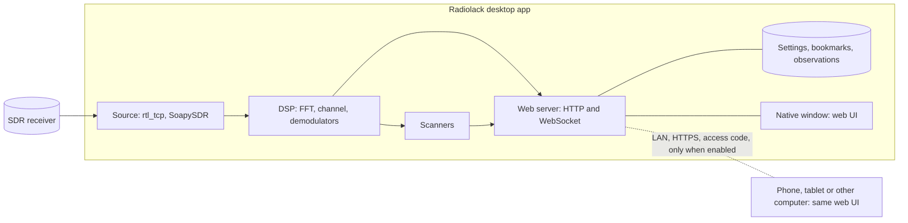

# Radiolack rewrite: scoping

Status: v0 started on the `rewrite` branch, 2026-11-08.
Visual reference: [`ui-mockup.html`](ui-mockup.html), validated on 2026-11-08
(simulated data, no receiver, no audio).

This document fixes what the rewritten Radiolack is, what it is not, how it is
built and in which order. Until the first milestone can stand in for it, `main`
keeps the current Gqrx-driven airband tool.

## Purpose

Radiolack becomes a standalone, receive-only SDR program for every frequency
its receiver covers, with a ham-focused interface: a band plan strip names
what each range is used for, with detailed plans inside the amateur bands. It
reads I/Q samples from an SDR receiver, shows a full-screen spectrum and
waterfall, demodulates and plays the signal, and scans the bands for
activity. It runs as a desktop application and can let a phone, a tablet or
another computer control it and listen to it over the local network. It
depends on no other radio program, only on receiver drivers.

## Decisions

| Date | Decision |
| --- | --- |
| 2026-11-08 | Standalone program for the amateur bands, inspired by SDR++, SDR#, SDRangel and OpenWebRX+. No dependency on Gqrx or any other radio program; receiver drivers (rtl_tcp, librtlsdr, SoapySDR) are fine. |
| 2026-11-08 | Receive-only. Transmit stays out of scope until the owner holds an amateur licence, and would then need a decision of its own. |
| 2026-11-08 | Same repository, rewritten from scratch on the `rewrite` branch. The name "Radiolack" shows discreetly in the top-left corner of the UI. |
| 2026-11-08 | Spectrum and waterfall fill the screen; discreet buttons open panels for fine-tuning; many display options; peak scanner and sweep scanner. |
| 2026-11-08 | Desktop application. A Settings option turns on a built-in web service so a phone, a tablet or another computer can control it and receive its audio. |
| 2026-11-08 | Phones are first-class remote clients (touch, portrait and landscape). No receiver is ever plugged into a phone. |
| 2026-11-08 | Maximum compatibility: the owner uses an iPhone, but every mainstream browser and the three desktop systems are targets. |
| 2026-11-08 | Making the program available to the public is the long-term goal: distributing it so that anyone can install it at home. Opening a receiver to anyone on the internet (a public WebSDR) is not a goal. |
| 2026-11-08 | The UI mockup is the visual reference. It can still change deeply. |
| 2026-11-08 | Desktop shell for v0: the system's WebKitGTK through PyGObject, validated by spike 1. Windows and macOS shells are chosen before v4. |
| 2026-11-09 | UI code: plain JavaScript ES modules served as they are, with no build step. Types are written in JSDoc comments and checked by TypeScript; only that check needs Node. Revisit if the UI needs a framework or npm libraries. |
| 2026-11-09 | English only: code, identifiers, comments, documentation and the interface. No other language and no translation layer; this replaces the English and French interface planned on 2026-11-08. |
| 2026-11-09 | All frequencies: Radiolack tunes and labels the whole range of its receivers, not only the amateur bands. The band plan covers 9 kHz to 6.425 GHz with a simplified European table (ITU Region 1 allocations named by their main use) and simplified IARU Region 1 plans inside the amateur bands ([`band-plan.md`](band-plan.md)). This replaces "for the amateur bands" (2026-11-08) and answers the open question on tuning. |
| 2026-11-09 | Browser tests (Playwright: Chromium, Firefox and WebKit) run headless and only on request (`RADIOLACK_BROWSER_TESTS=1`), as CI does; the usual test commands launch no browser. |

## Scope

In scope, across the milestones below:

- Receivers: RTL-SDR through rtl_tcp first, then SoapySDR devices.
- Frequencies: the whole range of the receiver; the band plan covers 9 kHz to
  6.425 GHz.
- Display: spectrum and waterfall with zoom and pan, palettes, averaging, peak
  hold, a band plan strip and bookmarks on the spectrum.
- Reception: one VFO (NFM, AM, USB, LSB, CW) with filter width, squelch and
  AGC. More VFOs only if a later need shows up.
- Scanners: peak detection, sweep across several receiver windows, memory scan
  over bookmarks.
- Band plans: Europe first (ITU Region 1, with the IARU Region 1 amateur
  plans), then the other regions.
- Remote access: control and audio over the local network.
- Language: English only.

Out of scope:

- Transmitting, in any form.
- Recording audio, transcriptions or raw I/Q (current repository rule; see the
  open questions).
- Receivers attached to phones, and native mobile apps.
- Opening a receiver to anyone on the internet (a public WebSDR).
- Driving other radio programs.

Dropped from the current code: the VHF airband explorer and its Gqrx bridge.
Their migrated history in `data/` stays untouched; it is never written,
replaced or deleted. What the new engine reuses from that code is summarised
in [`lessons.md`](lessons.md).

## Compatibility targets

| Area | Targets |
| --- | --- |
| Desktop app | Linux x86_64 first. Windows 10/11 and macOS (Apple silicon and Intel) for the public release. Proposed later: a headless mode on Linux arm64 (Raspberry Pi next to the antenna), used only through the web UI. |
| Remote clients | Safari on iOS and iPadOS, Chrome, Edge and Firefox on desktop and Android, Safari on macOS: current and previous major versions. |
| Receivers | RTL-SDR (R820T and R828D tuners, RTL-SDR Blog V3 and V4) first, then SoapySDR devices (Airspy, HackRF, SDRplay, LimeSDR, PlutoSDR). |
| Language | English only, whatever the system language. |

## Architecture

### Components

- **Engine** (Python 3.11+, asyncio, NumPy). It owns the receiver and all
  state.
  - Sources: an rtl_tcp client, with an rtl_tcp child process that Radiolack
    starts on a free local port; SoapySDR later; synthetic I/Q generated in
    memory for tests and demos (never recorded).
  - DSP: display FFT (window, averaging, peak hold), channel extraction (mix
    and decimate), NFM, AM, USB, LSB and CW demodulators, squelch, AGC, audio
    resampling.
  - Scanners: peaks, sweep, memory.
  - Storage: settings, bookmarks, band plans and observations in the
    platform's directories (XDG on Linux, AppData on Windows, Application
    Support on macOS).
  - Server: aiohttp, for HTTP and WebSocket in one dependency. It serves the
    UI files and, per client, spectrum rows (uint8 dB values), audio, state
    updates (JSON) and commands.
- **UI** (JavaScript ES modules, served as they are: no build step). Types
  live in JSDoc comments and TypeScript checks them without producing files;
  nothing else needs Node. No UI framework at first, like the mockup; revisit
  if the panels grow complex. WebGL2 spectrum and waterfall, AudioWorklet
  playback behind a jitter buffer, mouse, keyboard and touch input. The
  files ship inside the Python package as they are.
- **Desktop shell**: a native window that shows the UI served by the local
  engine on the loopback interface. On Linux it is the system's WebKitGTK
  through PyGObject (spike 1). Windows and macOS shells are chosen before v4,
  with pywebview (WebView2, WKWebView) as the candidate. Where no native
  window is available, `radiolack --ui browser` opens the UI in the default
  browser.

### Behaviour rules

- One receiver state is shared by every client: frequency, mode, filter,
  squelch, gain and scanners. A change from any client reaches the others at
  once, and the last change wins.
- View settings stay on each device: zoom, palette, panel layout, volume and
  mute.
- The engine sends audio only to clients that turned it on, and encodes each
  format once whatever the number of clients.
- Settings live in the engine. Security settings (remote access, access code)
  can only be changed from the local window.

### Remote access

- Off by default. When turned on, the engine also listens on the local
  network, over HTTPS only.
- The app generates an access code (no password to invent). A device enters
  it once and keeps a session; "New code" signs every device out. Failed
  attempts are rate-limited.
- Settings list the connected devices, which can be disconnected.
- From outside the home: through a VPN (Tailscale, WireGuard). Radiolack never
  asks the user to forward a port on their router.
- Remote clients need HTTPS anyway: browsers allow AudioWorklet, the wake lock
  and app installation only on secure pages. Spike 3 picks the certificate
  setup.

### Audio path

- v0: the engine sends 16-bit PCM over WebSocket to the local window, which
  plays it with an AudioWorklet. The local window uses the same path as remote
  clients, so v1 only adds compression and the network hop.
- v1: PCM on the local network (192 kbit/s for 12 kHz mono), Opus at about
  32 kbit/s for slower links, decoded by WebCodecs or by a WebAssembly decoder
  where WebCodecs lacks Opus.
- iPhone with the screen locked: Safari interrupts Web Audio when the screen
  locks or the page goes to the background. Spike 2 compares Safari's audio
  session API (`navigator.audioSession`) with a plain audio stream played by an
  `<audio>` element, which iOS keeps playing at the cost of a few seconds of
  delay.

### Privacy

- No telemetry and no account. Radiolack talks only to the receiver and to the
  clients the user lets in.
- Nothing personal in the repository: no owner-specific frequencies, places or
  call signs in code, examples or tests.

## Milestones

### v0: local desktop app (Linux)

Goal: replace Gqrx for the owner's daily listening on 2 m and 70 cm.

- Engine and native window; rtl_tcp source; sample rate, centre frequency,
  gain, PPM correction and DC removal.
- Spectrum and waterfall with the mockup's interactions (mouse, keyboard and
  touch).
- One VFO: NFM, AM, USB, LSB and CW, filter width, squelch, audio on the
  computer.
- Bookmarks and the band plan: all frequencies, with the IARU Region 1 plans
  inside the amateur bands.
- Settings panel with persistence; English interface.
- Tests without hardware: DSP on synthetic I/Q; engine and server over local
  sockets on ephemeral ports; UI tests in Chromium, Firefox and WebKit
  (Playwright); CI updated with job timeouts and cancellation.

Done when the owner confirms on their computer that Radiolack starts from its
launcher, shows the live band, tunes a local repeater with clean audio and
remembers its settings, and when every test passes in CI.

### v1: remote access

- Settings > Remote access as in the mockup: HTTPS, access code, connected
  devices.
- Remote clients: the same UI, touch input, shared receiver, a volume per
  device; PCM audio on the local network, Opus for slower links.
- iPhone: listening with the screen on; listening with the screen locked
  according to spike 2.

Done when, from the owner's iPhone on the home Wi-Fi, the owner can tune and
listen with less than half a second of delay, and no device connects without
the code.

### Later milestones

- v2, scanners: peak scanner, sweep scanner, memory scan, and an observation
  store separate from the protected airband history. v1 and v2 can swap if the
  scanners matter more than remote access.
- v3, receivers and bands: SoapySDR devices, HF (direct sampling, RTL-SDR Blog
  V4), band plans for the other regions.
- v4, public release: Windows and macOS builds, installers, code signing,
  updates, user documentation, licence, accessibility review, public
  repository.

## Spikes and risks

| # | Question | Why it matters | When |
| --- | --- | --- | --- |
| 1 | Does the native window (WebKitGTK) draw a full-screen WebGL2 waterfall smoothly and play AudioWorklet audio at a low CPU cost on the owner's laptop? | It chooses the desktop shell. | Done: yes, within the limits below. |
| 2 | How does an iPhone keep listening with the screen locked? | The owner's phone; Safari interrupts Web Audio in the background. | Start of v1 |
| 3 | Which HTTPS setup can a non-expert complete on an iPhone and on Android: a local certificate authority installed once per device, Tailscale certificates, or a certificate the user provides? | Remote clients need a secure page, and installing a certificate on iOS takes several steps. | Start of v1 |
| 4 | Python DSP load with scanners at 2.4 MS/s. | Measured on an i7-7500U: display FFT and one NFM channel take about 15% of one core, 23% with four channels. | v2 |
| 5 | Packaging Python, NumPy and drivers for Windows and macOS, including the WinUSB driver on Windows. | Public release. | Before v4 |

### Spike 1 result (2026-11-08)

A test page drew a WebGL2 waterfall (2048-bin rows, one per frame) under a
spectrum trace and ran a silent AudioWorklet, measured for 10 s after a 2.5 s
warm-up on the owner's laptop: i7-7500U, Intel HD 620 with Mesa 22.3.6,
Wayland, 59 Hz screen at scale 2. WebKitGTK 2.50.6 ran through PyGObject;
Chromium ran in app mode. CPU covers the whole process tree.

| Shell | Drawing size (device px) | Frames/s | 95th percentile frame | CPU (one core) | Audio |
| --- | --- | --- | --- | --- | --- |
| WebKitGTK, default policy | 3200 × 1662 | 52.2 | 26 ms | 57% | suspended |
| WebKitGTK, autoplay allowed | 3200 × 1662 | 50.6 | 28 ms | 82% | 48 kHz |
| Chromium | 2760 × 1628 | 57.2 | 19 ms | 84% | 48 kHz |
| WebKitGTK, autoplay allowed | 2400 × 1400 | 58.9 | 21 ms | 52% | 48 kHz |
| Chromium | 2360 × 1308 | 58.9 | 16.8 ms | 36% | 48 kHz |

- Both shells draw on the GPU. Up to about 3.4 million device pixels both
  keep up with the screen; at 5.3 million WebKitGTK drops to about 51
  frames/s while Chromium holds 57.
- At the same size Chromium uses less CPU (36% against 52% of one core).
- WebKitGTK keeps an AudioContext suspended until a user gesture, unless the
  web view is created with a policy that allows autoplay (WebKitGTK website
  policies, which can only be set when the view is created).

The mockup itself, served by the v0 skeleton in that window (1280 × 800 CSS
px, scale 2), runs at about 20 frames/s: its frame callback takes 40 ms, of
which 30 ms go to 2D-canvas `stroke()` calls for the spectrum traces and 7 ms
to `fill()`. In Chromium the same callback takes 2.5 ms.

Consequences:

- v0 uses WebKitGTK through PyGObject directly: system packages on Linux, no
  extra Python dependency, and control over options that must be set when the
  view is created, such as the autoplay policy.
- The UI draws the spectrum and the waterfall with WebGL2, not with 2D-canvas
  paths.
- The UI keeps its drawing buffers at about 3.4 million device pixels or less
  on large HiDPI windows, and starts audio on the first user gesture wherever
  autoplay is blocked, as remote browsers require anyway.

## Preparing a public release

Public distribution multiplies the work. These choices are cheap now and
expensive later, so they apply from v0:

- English only in code and interface: no translations to maintain.
- Band plans by region, with no owner-specific data.
- Cross-platform code paths only.
- Secure defaults for remote access.
- Dependencies whose licences fit the licence chosen for Radiolack.

These costs wait for v4:

- Code signing: the Apple Developer Program (99 USD a year) with
  notarisation, and a Windows signing certificate or signing service to avoid
  SmartScreen warnings.
- Installers and updates for three systems, built on each system (GitHub
  Actions minutes are free for public repositories).
- Support and documentation for other people's receivers and drivers.
- An audit of the git history before the repository becomes public.
- A check that the name "Radiolack" is free to use.

## Open questions

1. Licence: GPL-3.0-or-later matches most SDR software (Gqrx, SDR++, SDRangel)
   and makes it simple to ship GPL drivers such as librtlsdr. A permissive
   licence is possible but needs more care when bundling those drivers.
2. Recording: the repository forbids recording audio and raw I/Q today, while
   most SDR programs offer it. Keep the rule, or allow recording on demand?
3. Wide FM: the band plan shows FM broadcast (87.5 to 108 MHz), which needs a
   WFM demodulator, but the scope lists NFM, AM, USB, LSB and CW only. Add WFM
   to v0, or later?

## Repository plan

- `rewrite` branch created from `main` on 2026-11-08.
- v0 skeleton, 2026-11-08: the airband explorer's package, tests and docs are
  removed from the branch, after [`lessons.md`](lessons.md) kept what the new
  design needs. `radiolack` serves `src/radiolack/web/` (for now a copy of the
  mockup) on 127.0.0.1 and shows it in the native window, or in a browser.
  New `AGENTS.md` and `README.md` keep the safety rules; CI runs the new tests.
- Live display, 2026-11-09: the engine computes the display FFT (NumPy, 8192
  bins, about 30 frames/s) of a simulated 2 m band and streams it over a
  WebSocket ([`protocol.md`](protocol.md)) to the interface, which draws the
  spectrum and the waterfall with WebGL2 and keeps the mockup's panels and
  interactions. The interface is plain ES modules, type-checked from their
  JSDoc. Measured in the native window on the owner's laptop (1280 × 800 CSS
  px at scale 2; other programs were busy, so CPU figures vary by about
  ±10 points between runs): 56 to 60 frames/s against 20 for the mockup, a
  frame callback of about 1 ms, and 1.05 to 1.2 cores for the whole process
  tree while streaming: about 0.5 in the WebKit web process, 0.3 on the GTK
  main thread and 0.25 for the synthetic source and the FFT. With the stream
  open and no frames, the tree takes 0.08 to 0.13 cores; a static page takes
  0.01.
- Band plan, 2026-11-09: the strip, the readouts and the Bands panel read a
  band plan file served with the interface ([`band-plan.md`](band-plan.md)):
  198 bands from 9 kHz to 6.425 GHz, 81 segments inside them, checked by the
  tests and against the sources it names. The engine still captures the
  simulated 2 m band only.
- rtl_tcp source, 2026-11-09: `radiolack --rtl-tcp [ADDRESS]` reads an
  RTL-SDR receiver through an rtl_tcp server that the user runs. The source
  state (connection, tuner, settings) reaches every interface, which can set
  the centre frequency, the sample rate and the gain (protocol version 2); a
  typed frequency or a bookmark outside the span moves the span. A refused,
  silent or lost connection is a waiting state, retried by itself, and the
  source hangs up while no interface listens. Tested against a fake rtl_tcp
  server; not yet with a receiver.
- Managed rtl_tcp, 2026-11-09: `radiolack --rtl-sdr [DEVICE]` runs rtl_tcp
  itself, on 127.0.0.1 and a free port, for each connection, and stops it
  when the source hangs up or Radiolack stops, so that the receiver stays
  free for other programs while no interface listens; on Linux, setpriv has
  the kernel stop it should Radiolack die first. A receiver that rtl_tcp
  cannot open (none found, in use, no permission) is a waiting state with
  that reason. Tested with a fake rtl_tcp program; not yet with a receiver.
- Frequency correction and DC removal, 2026-11-09: the Source panel sets the
  receiver's correction in whole ppm, -100 to +100 (rtl_tcp command 5, sent
  at each connection like the other settings, with 0.4 s of settling after a
  change). DC removal is the engine's own setting, on by default and shared
  by every interface: it takes each block's mean off the samples before the
  FFT, which also removes a signal exactly on the centre frequency, and will
  apply to demodulation too. Tested with the fakes; not yet with a receiver.
- Type check and browser tests in CI, 2026-11-09: a second workflow, which
  runs only when the package, the tests or `pyproject.toml` change, checks
  the interface's types and runs Playwright tests in headless Chromium,
  Firefox and WebKit against the simulated band and the fake rtl_tcp
  program: the stream, the Source panel, and a change made in one interface
  showing in another. WebKit 27.2 refuses its own stylesheet for each
  `<select>` under the interface's policy, without visible effect
  (WebKitGTK 2.50 does not): the tests ignore that one message in WebKit.
  On GitHub's runner (Ubuntu 26.04, no GPU), Firefox first refused
  WebGL2: without a GPU it refuses Mesa's software renderer and needs a
  display, so the tests set its `webgl.force-enabled` preference and the
  workflow runs them under Xvfb, as checked locally with the GPU hidden.
- Next step: demodulation and audio on the computer, starting with NFM.
- `data/` stays untracked and untouched; `data/airband-peaks.json` is never
  written, replaced or deleted.
- `main` keeps the current tool until v0 is merged.
